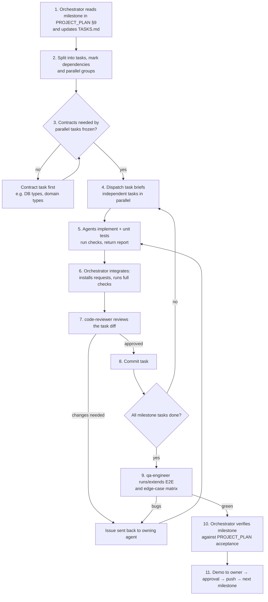

# Agent Workflow

How the AI agent team builds this project. Product scope and architecture are in
[PROJECT_PLAN.md](PROJECT_PLAN.md); coding rules are in [DEVELOPMENT_GUIDELINES.md](DEVELOPMENT_GUIDELINES.md).
This file **supersedes PROJECT_PLAN §10** where they differ (see DEC-002 … DEC-004 in [DECISIONS.md](DECISIONS.md)).

---

## 1. How Claude Code shapes this setup

| Fact about Claude Code subagents | Consequence for us |
|---|---|
| A subagent cannot start another subagent. | The **Orchestrator is the main session**, not a subagent. All delegation goes through it. |
| Subagents cannot message each other. | The Orchestrator is the **communication hub**: every report comes back to it; it forwards what the next agent needs. |
| Each subagent starts with a fresh context (no memory of earlier runs). | Every task brief must be **self-contained**: task ID, goal, files, contracts, acceptance criteria. Shared knowledge lives in the repo docs, not in chat history. |
| Several subagents can run at the same time in the same working tree. | Parallel work is safe **only** when the agents touch disjoint directories — hence strict file ownership (§3). |
| Tool access is set per agent (`tools:` in the agent file); directory limits are not. | Ownership is enforced by the agent instructions, ESLint boundary rules, and review. |

---

## 2. The team

| Agent | File | Covers roles | Active in milestones |
|---|---|---|---|
| **Orchestrator** (main session) | [CLAUDE.md](CLAUDE.md) | Project Orchestrator, architecture authority, integration | all |
| `db-engineer` | [.claude/agents/db-engineer.md](.claude/agents/db-engineer.md) | Database Specialist + Backend (Supabase SQL, RLS, RPC) | M1, M11 |
| `core-engineer` | [.claude/agents/core-engineer.md](.claude/agents/core-engineer.md) | Domain logic + data-access layer (repositories, errors) | M1, M2, M5–M7 |
| `frontend-engineer` | [.claude/agents/frontend-engineer.md](.claude/agents/frontend-engineer.md) | UI system, app shell, all features except the timetable | M1, M3, M4, M6, M7 |
| `scheduler-engineer` | [.claude/agents/scheduler-engineer.md](.claude/agents/scheduler-engineer.md) | Timetable, drag & drop, tap-to-place, mobile planner view | M5, M7 |
| `platform-engineer` | [.claude/agents/platform-engineer.md](.claude/agents/platform-engineer.md) | Platform adapter, PWA, Tauri, Capacitor, deploy & release pipelines | M6, M8–M9, M11 |
| `qa-engineer` | [.claude/agents/qa-engineer.md](.claude/agents/qa-engineer.md) | End-to-end tests, edge-case matrix, bug reports | M4 onward |
| `code-reviewer` | [.claude/agents/code-reviewer.md](.claude/agents/code-reviewer.md) | Code review, security, architecture-drift guard (read-only) | every task |

**Not created on purpose:** a separate *Backend Developer* (there is no custom server — the backend is Supabase SQL, owned by `db-engineer`), an *AI/Integrations* agent (AI is Phase 2; create it when P2-2 is scheduled), and a separate *Software Architect* (architecture authority = Orchestrator; drift detection = `code-reviewer` + ESLint).

---

## 3. File ownership

One owner per path. An agent that needs a change in a path it does not own **asks the Orchestrator** in its report; it does not edit.

| Path | Owner |
|---|---|
| `CLAUDE.md`, `AGENT_WORKFLOW.md`, `DEVELOPMENT_GUIDELINES.md`, `DECISIONS.md`, `TASKS.md`, `PROJECT_PLAN*.md`, `docs/decisions/`, `README.md`, `.claude/`, `scripts/` | Orchestrator |
| `package.json`, `package-lock.json` (all dependency changes) | Orchestrator |
| Root configs: `vite.config.ts`, `tsconfig.json`, `eslint.config.js`, `.prettierrc.json`, `.github/workflows/ci.yml`, `src/test/setup.ts` | Orchestrator |
| `supabase/**`, `src/data/database.types.ts` (generated) | `db-engineer` |
| `src/domain/**`, `src/data/**` (except `database.types.ts`) | `core-engineer` |
| `src/app/**`, `src/components/ui/**`, `src/styles/**`, `src/i18n/**`, `src/features/{auth,trips,bank,import,export,backup}/**` | `frontend-engineer` |
| `src/features/schedule/**` | `scheduler-engineer` |
| `src/platform/**`, `index.html` (meta/link tags), `src-tauri/**`, `android/**`, `ios/**`, `public/**`, `pwa.config.ts`, `.github/workflows/` other than `ci.yml` | `platform-engineer` |
| `tests/e2e/**`, `tests/fixtures/**`, `playwright.config.ts` | `qa-engineer` |
| — (read-only) | `code-reviewer` |

**Shared-file conventions**

- `src/i18n/he.json` — owned by `frontend-engineer`; `scheduler-engineer` may **add** keys under the `schedule.*` namespace only.
- `src/app/router.tsx` — owned by `frontend-engineer`; other agents request new routes.
- Dependencies — agents list needed packages in their report ("Requests"); the Orchestrator installs them before or after the task.
- Unit tests live next to the code (`*.test.ts[x]`) and belong to the owner of that code.

---

## 4. Development lifecycle (per milestone)



Rules:

1. **No dependent task starts before its prerequisite is committed.** Parallel only across disjoint ownership.
2. **Contracts first.** Interfaces shared by parallel tasks (DB types, domain types, repository signatures, UI primitive props) are agreed and committed before consumers start.
3. **One task = one reviewed commit.** Message format: `M1.3: <summary>`.
4. **Review is mandatory**; QA is mandatory per milestone (and per task when it touches behavior already covered by E2E).
5. Small reviewer findings may be fixed in the same loop; anything that changes a contract or a decision goes to DECISIONS.md first.

---

## 5. Task brief (Orchestrator → agent)

Every delegation uses this template. Agents start cold, so include everything they need.

```text
TASK: <ID> — <title>
GOAL: <user-visible or contract outcome>
REQUIREMENTS: <FR/NFR IDs and PROJECT_PLAN sections to read>
INPUTS / CONTRACTS: <files or interfaces to rely on; their current state>
FILES YOU MAY CHANGE: <paths within your ownership>
DO NOT: <explicit exclusions for this task>
ACCEPTANCE CRITERIA:
  - <testable criterion>
TESTS REQUIRED: <unit / component / DB tests>
CONTEXT FROM OTHER AGENTS: <relevant findings forwarded by the Orchestrator>
```

## 6. Report (agent → Orchestrator)

Every agent ends its run with exactly this structure:

```text
STATUS: DONE | PARTIAL | BLOCKED
SUMMARY: <2–5 sentences of what was done>
FILES CHANGED: <list>
CONTRACT CHANGES: none | <what changed and who is affected>
TESTS: <what was added; result of lint/typecheck/test>
DECISIONS NEEDED / MADE: <anything the Orchestrator must record or decide>
REQUESTS: <dependencies to install, changes needed in files owned by others>
BLOCKERS: none | <what, why, what would unblock it>
NEXT: <suggested follow-ups>
```

**Blockers are reported immediately**: an agent that cannot proceed stops and returns `STATUS: BLOCKED` instead of guessing or working around another agent's files.

---

## 7. Decisions and disagreements

- Any change to architecture, a shared contract, a dependency, or a plan requirement is a **decision**: the agent proposes it in its report; the Orchestrator decides, logs it in DECISIONS.md, and (if it changes the plan) updates PROJECT_PLAN.md + PROJECT_PLAN.he.md.
- If the reviewer and an implementer disagree, the Orchestrator decides with reference to PROJECT_PLAN.md; product-scope questions go to the owner.

## 8. Human checkpoints (owner)

| When | What the owner does |
|---|---|
| Steps needing secrets (e.g. linking the Supabase CLI) | Types the password locally; never shares it in chat |
| End of each milestone | Sees a demo, approves or requests changes |
| Scope or product questions | Decides; the Orchestrator records it |
| Outward-facing actions (store publishing, public URLs, paid plans) | Explicit approval |

---

## 9. Known bottlenecks and how we handle them

| Bottleneck | Mitigation |
|---|---|
| The Orchestrator is a single hub; long sessions fill its context. | Keep reports short (format §6); keep state in TASKS.md / DECISIONS.md so a new session can resume. |
| Subagents start cold every time. | Self-contained briefs; agents read only the plan sections named in the brief. |
| Shared files (`he.json`, `router.tsx`, `package.json`). | Single owner + namespace/request conventions (§3). |
| Review after every task is sequential. | Review small tasks; run reviewer while the next independent task is being implemented. |
| Owner approval at milestone end. | Demo early in the milestone for the risky parts (e.g. M5.1 spike). |
| Steps that need the owner's secrets. | Scheduled at the start of a milestone so they don't block mid-way. |

---

## 10. Starting work

The owner can say (in Hebrew or English) "continue with the next milestone", or run:

```text
/milestone M1
```

The `/milestone` command ([.claude/commands/milestone.md](.claude/commands/milestone.md)) tells the Orchestrator to run the lifecycle above for that milestone.

### Example: first milestone (M1 + the parallel M2/M3 starts)

PROJECT_PLAN §10.5 allows M1 ‖ M2 ‖ M3 after M0. Concretely:

| Wave | In parallel | Why it can run now |
|---|---|---|
| 0 | Owner links the Supabase CLI (M0.6) | Needs the DB password — human step |
| 1 | `db-engineer`: M1.1 schema → M1.2 triggers → M1.3 RLS → M1.4 RPCs → M1.5 DB tests (sequential inside the agent) ‖ `core-engineer`: M2.1 domain types & constants ‖ `frontend-engineer`: M3.1 UI primitives + M3.2 ConfirmDialog | Disjoint directories; no shared contracts between them yet |
| 2 | `db-engineer`: M1.6 generate `database.types.ts` | Needs M1.1–M1.4 committed |
| 3 | `core-engineer`: M1.7 repositories ‖ `core-engineer` later: M2.2–M2.4 | Needs generated types (M1.6) + domain types (M2.1) |
| 4 | `frontend-engineer`: M1.8 login UI + route guard | Needs repositories (M1.7) and ConfirmDialog/primitives (M3.x) |
| each task | `code-reviewer` reviews → Orchestrator commits | — |
| end | `qa-engineer`: first Playwright setup + login smoke test; Orchestrator demo to owner | Milestone verification |
