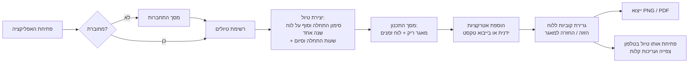
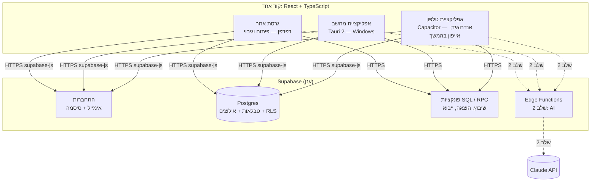
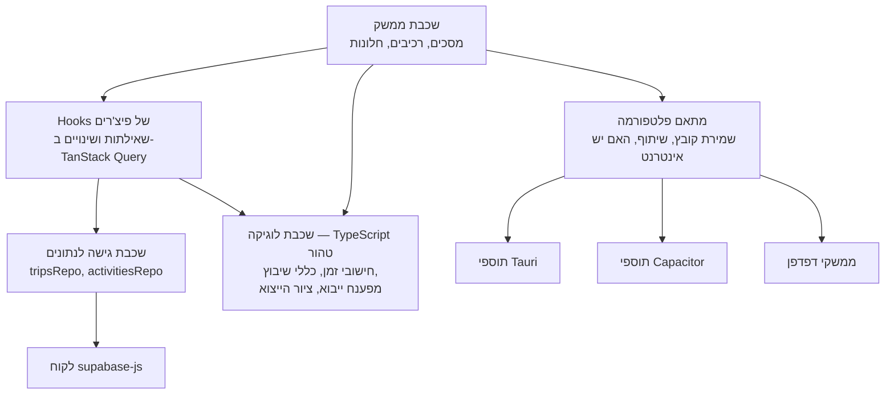
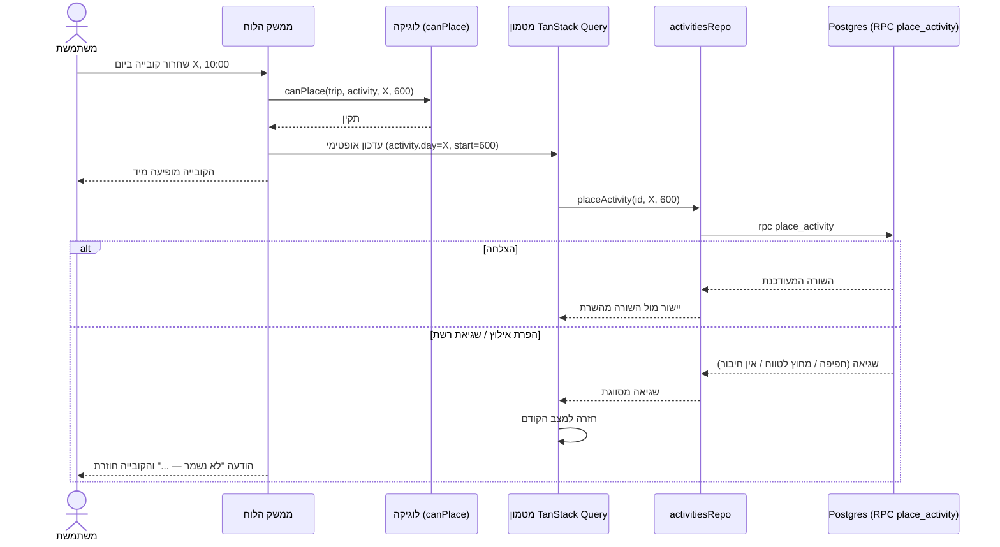
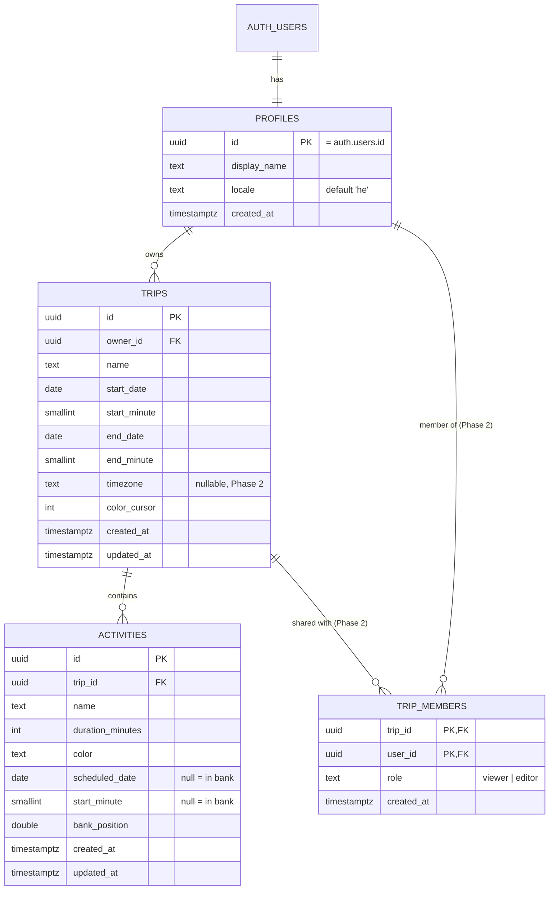

<div dir="rtl">

# מתכנן הטיולים — תוכנית הפרויקט

| | |
|---|---|
| **סטטוס** | הכיוון אושר, מוכן לפיתוח |
| **גרסה** | 1.1 — 12.11.2026 (האייפון נדחה) |
| **בעלת המוצר** | משתמשת יחידה, בונה בעזרת סוכני AI לכתיבת קוד |
| **אב-טיפוס לעיון** | [`index.html`](index.html) — אב-טיפוס עובד בקובץ אחד; הוא המקור המחייב למראה ולתחושה |
| **מקור** | זהו תרגום של [`PROJECT_PLAN.md`](PROJECT_PLAN.md). אם יש הבדל, הגרסה האנגלית קובעת. |

**מקרא לאורך המסמך**

- **[מ]** = *דרישה מאושרת*: התבקשה או אושרה במפורש על ידי בעלת המוצר.
- **[ה]** = *המלצה*: הצעה של הארכיטקט; אפשר לשנות אותה בלי לפתוח מחדש את היקף המוצר.
- **[נ]** = *הנחה*: מתועדת ב[סעיף 12](#12-שאלות-פתוחות-והנחות); אם היא שגויה צריך לחזור אליה.

שמות טכניים (טבלאות, פונקציות, תיקיות, ספריות) נשארו באנגלית, כי כך הם יופיעו בקוד.

---

## תוכן עניינים

1. [סקירת הפרויקט ומטרות](#1-סקירת-הפרויקט-ומטרות)
2. [דרישות פונקציונליות](#2-דרישות-פונקציונליות)
3. [דרישות לא-פונקציונליות](#3-דרישות-לא-פונקציונליות)
4. [ארכיטקטורת המערכת](#4-ארכיטקטורת-המערכת)
5. [מחסנית הטכנולוגיות](#5-מחסנית-הטכנולוגיות)
6. [תכנון מסד הנתונים](#6-תכנון-מסד-הנתונים)
7. [תכנון ממשקים ושילובים](#7-תכנון-ממשקים-ושילובים)
8. [פירוק לפיצ'רים](#8-פירוק-לפיצרים)
9. [מפת דרכים לפיתוח](#9-מפת-דרכים-לפיתוח)
10. [ארכיטקטורת ריבוי סוכנים](#10-ארכיטקטורת-ריבוי-סוכנים)
11. [סיכונים ואתגרים טכניים](#11-סיכונים-ואתגרים-טכניים)
12. [שאלות פתוחות והנחות](#12-שאלות-פתוחות-והנחות)

---

## 1. סקירת הפרויקט ומטרות

### 1.1 המוצר במשפט אחד

מתכנן טיולים חזותי: המטיילת מגדירה את חלון הזמן של הטיול, בונה מאגר של "קוביות אטרקציה" צבעוניות שגובהן משקף את משך הזמן שלהן, וגוררת אותן ללוח זמנים בחלוקה לחצאי שעה, שמכסה את כל ימי הטיול.

### 1.2 מה מייחד אותו

רוב מתכנני הטיולים (TripIt, Wanderlog, Google Travel) הם רשימות ומפות. המוצר הזה הוא **מערכת שעות**: הערך המרכזי הוא *לראות* איך הימים מתמלאים ולסדר את הזמן באופן מוחשי. כל החלטה על היקף צריכה לשמור על האינטראקציה המרכזית הזו. פיצ'רים שלא מחזקים "תכנון זמן חזותי" נדחים.

### 1.3 מטרות

| # | מטרה | סוג |
|---|---|---|
| G1 | לתכנן טיול של כמה ימים באופן חזותי: חלון הטיול ← מאגר אטרקציות ← גרירה ללוח. | [מ] |
| G2 | הנתונים נשמרים במסד נתונים אמיתי, לא בדפדפן, והם זהים בכל המכשירים. | [מ] |
| G3 | זמין כאפליקציית מחשב (Windows) וכאפליקציית טלפון (אנדרואיד). האייפון נדחה, והארכיטקטורה משאירה אותו אפשרי. | [מ] |
| G4 | משתמשת אחת עכשיו; הארכיטקטורה מוכנה לריבוי משתמשים בהמשך בלי לכתוב מחדש את מבנה הנתונים. | [מ] |
| G5 | עברית, מימין לשמאל, וזהות חזותית פסטלית ועדינה כמו באב-הטיפוס. | [מ] |
| G6 | ניתן לתחזוקה על ידי בעלת מוצר אחת שאינה מומחית, בעבודה עם סוכני AI: מעט טכנולוגיות, גבולות מודולים ברורים, בדיקות חזקות. | [ה] |

### 1.4 מה במפורש לא נכלל (כרגע)

| לא נכלל | סיבה / מתי |
|---|---|
| מידע על מקומות (חיפוש, כתובות, שעות פתיחה, תמונות, מפות) | [מ] הוחרג על ידי בעלת המוצר. בעתיד. |
| אטרקציות שחוצות את חצות או נמשכות כמה ימים (טיסות, מלונות) | [מ] שלב 2. |
| יכולות AI | [מ] שלב 2. ה-AI *יעזור* (יציע, יסדר), ולעולם לא יתכנן את הטיול לבדו. |
| ריבוי משתמשים, הרשמה, שיתוף | [מ] שלב 2. מבנה הנתונים מוכן כבר עכשיו. |
| שפות ממשק נוספות על עברית | [מ] בהמשך; תשתית התרגום נבנית כבר מהיום הראשון [ה]. |
| הזמנות, תקציב, רשימות ציוד, מזג אוויר | בעתיד. |
| אפליקציה לאייפון | [מ] נדחתה; לא נדרשת כרגע. |

### 1.5 מסע המשתמשת העיקרי (MVP)



### 1.6 תרחישי שימוש

| מזהה | תרחיש |
|---|---|
| UC1 | תכנון חופשה עירונית (2–5 ימים) ליד המחשב, עם שיפורים לאורך כמה פעמים. |
| UC2 | הדבקת רשימת אטרקציות (מפתקים, מאקסל או משיחה עם AI) כדי למלא את המאגר בבת אחת. |
| UC3 | תכנון מחדש מהטלפון בזמן הטיול (להעביר את המוזיאון של מחר לאחר הצהריים). |
| UC4 | ייצוא התוכנית לתמונה או ל-PDF כדי לשלוח לשותפים לטיול. |
| UC5 | שמירת כמה טיולים (קודמים, נוכחי, עתידיים) ומעבר ביניהם. |

---

## 2. דרישות פונקציונליות

העדיפות לפי MoSCoW: **חובה** (חוסם את ה-MVP), **רצוי** (ב-MVP, יכול להידחות מעט), **אפשרי** (מועמד לשלב 2).

### 2.1 חשבון וגישה

| מזהה | דרישה | עדיפות | מקור |
|---|---|---|---|
| FR-1.1 | המשתמשת מתחברת עם אימייל וסיסמה. | חובה | [ה] (נדרש למסד נתונים בענן, G2/G4) |
| FR-1.2 | החיבור נשמר בין הפעלות של האפליקציה בכל מכשיר. | חובה | [ה] |
| FR-1.3 | הרשמה ציבורית חסומה ב-MVP; החשבון היחיד נוצר על ידי בעלת המוצר. | חובה | [ה] בעקבות [מ] משתמשת אחת |
| FR-1.4 | המשתמשת יכולה להתנתק. | חובה | [ה] |
| FR-1.5 | איפוס סיסמה דרך אימייל. | רצוי | [ה] |

### 2.2 טיולים

| מזהה | דרישה | עדיפות | מקור |
|---|---|---|---|
| FR-2.1 | המשתמשת יכולה ליצור כמה טיולים ולעבור ביניהם. | חובה | [מ] |
| FR-2.2 | לטיול יש שם (1–50 תווים; ברירת מחדל "הטיול שלי"). | חובה | [מ] |
| FR-2.3 | תאריכי הטיול נבחרים על **לוח שנה אחד**: לחיצה ראשונה = יום ההתחלה, לחיצה שנייה = יום הסיום, והטווח נצבע. לא שני בוחרי תאריכים נפרדים. | חובה | [מ] |
| FR-2.4 | שעת ההתחלה ושעת הסיום נבחרות ליד לוח השנה, בקפיצות של 30 דקות. התחלה: 00:00–23:30; סיום: 00:30–24:00. | חובה | [מ] |
| FR-2.5 | הסוף חייב להיות אחרי ההתחלה; אורך טיול מקסימלי 90 ימים. | חובה | [ה] |
| FR-2.6 | שינוי חלון הטיול מחזיר למאגר אטרקציות שנשארו מחוץ לחלון, ומדווח כמה הוחזרו. | חובה | [מ] (התנהגות האב-טיפוס) |
| FR-2.7 | מחיקת טיול דורשת אישור בחלון, ומוחקת גם את האטרקציות שלו. | חובה | [מ] |
| FR-2.8 | רשימת הטיולים מציגה שם, טווח תאריכים ומספר ימים, ממוינת לפי תאריך ההתחלה. | חובה | [ה] |

### 2.3 מאגר האטרקציות

| מזהה | דרישה | עדיפות | מקור |
|---|---|---|---|
| FR-3.1 | אפשר להוסיף כמה אטרקציות שרוצים: שם (1–60 תווים), משך (30 דקות עד 24 שעות, בקפיצות של 30 דקות), צבע. | חובה | [מ] |
| FR-3.2 | הצבעים מגיעים מפלטה קבועה של 10 צבעי פסטל; אטרקציה חדשה מקבלת אוטומטית את הצבע הבא, ואפשר לשנות אותו. | חובה | [מ] |
| FR-3.3 | הקוביות צבעוניות ו**גובהן יחסי למשך הזמן**, באותו קנה מידה במאגר ובלוח. | חובה | [מ] |
| FR-3.4 | מחיקת אטרקציה (מהמאגר או מהלוח) תמיד שואלת "בטוח?" בחלון קטן. | חובה | [מ] |
| FR-3.5 | לחיצה על קובייה פותחת חלון עריכה (שם, משך, צבע; ו"החזרה למאגר" אם היא משובצת). | חובה | [מ] (אב-טיפוס) |
| FR-3.6 | אם משך הזמן שנערך כבר לא נכנס במקום שלה בלוח, האטרקציה חוזרת למאגר עם הודעה. | חובה | [מ] (אב-טיפוס) |
| FR-3.7 | שיבוץ אטרקציה בלוח **מוציא אותה מהמאגר**; החזרה שלה מוסיפה אותה לסוף המאגר. | חובה | [מ] |

### 2.4 לוח הזמנים

| מזהה | דרישה | עדיפות | מקור |
|---|---|---|---|
| FR-4.1 | בלוח יש עמודה לכל יום בטיול ושורה לכל 30 דקות, מ-00:00 עד 24:00. | חובה | [מ] |
| FR-4.2 | משבצות לפני תחילת הטיול (ביום הראשון) ואחרי סופו (ביום האחרון) מסומנות כלא זמינות ואי אפשר לשבץ בהן. | חובה | [מ] |
| FR-4.3 | כותרות הימים מציגות יום בשבוע (בעברית), תאריך ו"יום N". | חובה | [מ] (אב-טיפוס) |
| FR-4.4 | בפתיחת טיול, הלוח נגלל לשעת ההתחלה של הטיול. | רצוי | [ה] |
| FR-4.5 | קוביות משובצות מציגות שם וטווח שעות. | חובה | [מ] |
| FR-4.6 | אטרקציות לא יכולות לחפוף ולא יכולות לחצות את חצות (ב-MVP). | חובה | [מ]/[ה] |

### 2.5 שיבוץ

| מזהה | דרישה | עדיפות | מקור |
|---|---|---|---|
| FR-5.1 | **מחשב:** גרירת קובייה מהמאגר ללוח; גרירה בתוך הלוח כדי להזיז; גרירה חזרה למאגר כדי להוציא. | חובה | [מ] |
| FR-5.2 | בזמן גרירה מופיעה תצוגה מקדימה של המקום: ירוק = תקין, אדום = לא תקין; שחרור במקום לא תקין נדחה עם הודעה. | חובה | [מ] (אב-טיפוס) |
| FR-5.3 | הצמדה למשבצות של 30 דקות. | חובה | [מ] |
| FR-5.4 | גלילה אוטומטית של הלוח כשגוררים ליד הקצוות. | חובה | [ה] |
| FR-5.5 | **טלפון:** מצב "הקשה לשיבוץ" (הקשה על קובייה ← הקשה על משבצת פנויה) בנוסף לגרירה, כי גרירה על מסך קטן לא אמינה. | חובה | [ה] |
| FR-5.6 | חלופה במקלדת לשיבוץ (נגישות). | רצוי | [ה] |
| FR-5.7 | שינויים מוצגים מיד (באופן אופטימי) ומתבטלים עם הודעת שגיאה אם השמירה נכשלה. | חובה | [ה] |

### 2.6 ייבוא טקסט

| מזהה | דרישה | עדיפות | מקור |
|---|---|---|---|
| FR-6.1 | חלון "ייבוא" מקבל **טקסט מודבק בלבד** (בלי העלאת קבצים). | חובה | [מ] |
| FR-6.2 | פורמטים נתמכים: שורה לכל אטרקציה `שם; משך`; `{שם;משך},{שם;משך}`; שתי עמודות מופרדות בטאב (הדבקה מאקסל). | חובה | [מ] |
| FR-6.3 | פורמטים של משך: `3`, `1.5`, `1,5`, `2:30`, `40 דקות`, `2 שעות`, `שעתיים`, `2 שעות וחצי`, `שעה וחצי`, `חצי שעה`. מעוגל ל-30 הדקות הקרובות (ומסומן "עוגל"). | חובה | [מ] (אב-טיפוס) |
| FR-6.4 | תצוגה מקדימה חיה: שורות תקינות (עם הצבע שיקבלו והמשך שזוהה) ושורות שגויות (עם הסיבה). רק שורות תקינות מיובאות. | חובה | [מ] |
| FR-6.5 | עד 200 שורות בכל ייבוא. | חובה | [ה] |

### 2.7 ייצוא

| מזהה | דרישה | עדיפות | מקור |
|---|---|---|---|
| FR-7.1 | ייצוא לוח הזמנים של הטיול כ-PNG. | חובה | [מ] |
| FR-7.2 | ייצוא כ-PDF (A4, עד 7 ימים בעמוד, כיוון העמוד נבחר לכל עמוד). | חובה | [מ] |
| FR-7.3 | בחירת טווח שעות: "שעות רלוונטיות" (08:00–22:00, מורחב כך שיכלול את כל האטרקציות המשובצות) או "כל היממה". | חובה | [מ] (אב-טיפוס) |
| FR-7.4 | הייצוא עובד בלי אינטרנט (בלי תלות בשרתים חיצוניים). | חובה | [ה] |
| FR-7.5 | בטלפון הייצוא פותח את חלון השיתוף של המערכת; במחשב, חלון "שמירה בשם". | חובה | [ה] |

### 2.8 ניידות נתונים ועבודה בלי אינטרנט

| מזהה | דרישה | עדיפות | מקור |
|---|---|---|---|
| FR-8.1 | ייבוא טיולים מהאב-טיפוס (דרך קובץ גיבוי JSON, שייווצר בתוספת קטנה לאב-טיפוס). | חובה | [מ] |
| FR-8.2 | ייצוא וייבוא של גיבוי JSON מלא של כל הטיולים. | רצוי | [ה] |
| FR-8.3 | הטיולים שנצפו לאחרונה זמינים לקריאה בלי אינטרנט בכל מכשיר; עריכה דורשת חיבור, והממשק אומר זאת. | רצוי | [ה] |

### 2.9 שפה ותצוגה

| מזהה | דרישה | עדיפות | מקור |
|---|---|---|---|
| FR-9.1 | כל הממשק בעברית, מימין לשמאל. | חובה | [מ] |
| FR-9.2 | כל הטקסטים בממשק נמצאים בקובצי תרגום כבר מהיום הראשון, כך שאפשר להוסיף שפה בלי לשנות קוד. | חובה | [ה] בעקבות [מ] |
| FR-9.3 | הזהות החזותית הפסטלית של האב-טיפוס (פלטת צבעים, צורות מעוגלות, פונט Rubik). | חובה | [מ] |

---

## 3. דרישות לא-פונקציונליות

| מזהה | קטגוריה | דרישה | מדד / קבלה |
|---|---|---|---|
| NFR-1 | אמינות | אין אובדן נתונים שקט. כל שינוי נשמר, או שהמשתמשת מקבלת הודעה שהוא נכשל. | לכל פעולת שינוי יש טיפול בשגיאות וביטול; נבדק בבדיקות קצה-לקצה עם כשל רשת מדומה. |
| NFR-2 | שלמות נתונים | מסד הנתונים עצמו דוחה מצבים לא תקינים (חפיפות, חריגה מהטווח, משכים שגויים), לא רק הממשק. | אילוצים במסד + בדיקות (6.4). |
| NFR-3 | ביצועים | מסך התכנון שמיש בטיול של 30 יום ב-60 פריימים לשנייה בזמן גרירה; טיול של 90 יום נשאר שמיש. | מדידה ידנית על מחשב נייד וטלפון ממוצעים. |
| NFR-4 | ביצועים | מהפעלה ועד רשימת הטיולים: פחות מ-3 שניות בחיבור רגיל. | נמדד באפליקציית המחשב ובאנדרואיד. |
| NFR-5 | אבטחה | כל משתמש יכול לקרוא ולכתוב רק את הנתונים שלו (נאכף במסד). אין סודות בצד הלקוח. | מדיניות RLS + בדיקות RLS אוטומטיות. |
| NFR-6 | פרטיות | הנתונים נשמרים רק במופע ה-Supabase של הפרויקט (אזור EU [ה]); אין כלי אנליטיקה או מעקב של צד שלישי ב-MVP. | בדיקת הגדרות. |
| NFR-7 | נגישות | ניגודיות טקסט לפחות WCAG AA על כל צבעי הפסטל; כל הפעולות אפשריות בלי גרירה; פוקוס נראה; חלונות לוכדים פוקוס ונסגרים ב-Esc. | בדיקת axe בבדיקות קצה-לקצה + ידנית. |
| NFR-8 | שמישות | תכנון בעיקר במחשב; הטלפון שמיש לגמרי לצפייה ולעריכות קלות. רוחב מינימלי נתמך 360 פיקסלים. | בדיקה ידנית בגדלי טלפון. |
| NFR-9 | ניידות בין פלטפורמות | קוד ממשק אחד שממנו נבנים אתר, Windows ואנדרואיד (ואייפון בהמשך). | בנייה אוטומטית של אתר, Windows ואנדרואיד. |
| NFR-10 | תחזוקתיות | TypeScript במצב strict; בדיקות סגנון ועיצוב קוד נאכפות; כיסוי בדיקות של לפחות 90% בשכבת הלוגיקה; מודולים של פיצ'רים לא מייבאים זה את הפנימיות של זה. | שערים בבנייה האוטומטית (CI). |
| NFR-11 | הרחבה | הוספת משתמשים, שיתוף, אטרקציות של כמה ימים ושפה שנייה דורשות שינויי מסד שמוסיפים בלבד, לא כתיבה מחדש. | סקירות תכנון מול סעיפים 6 ו-8. |
| NFR-12 | עלות | ה-MVP רץ על מסלולים חינמיים. | חשבון חודשי = 0 דולר. |

---

## 4. ארכיטקטורת המערכת

### 4.1 החלטה מרכזית: מסד נתונים בענן עם לקוחות דקים [ה]

בעלת המוצר רוצה (א) נתונים שלא נשמרים בדפדפן, (ב) אותם נתונים במחשב ובטלפון, (ג) משתמשים בהמשך. מסד נתונים מקומי בכל מכשיר היה מפצל את הנתונים בין המכשירים, וסנכרון בין מסדים מקומיים מסובך (יישוב התנגשויות) ולא פרופורציונלי למוצר הזה. **לכן: מסד נתונים אחד בענן (Supabase Postgres), שכל הלקוחות ניגשים אליו ישירות.**

| אפשרות שנשקלה | הכרעה |
|---|---|
| SQLite מקומי בכל מכשיר | ✗ הנתונים שונים בכל מכשיר; סותר את G2. |
| מקומי-קודם עם מנוע סנכרון (למשל PowerSync, ElectricSQL) | ✗ ל-MVP. חזק, אבל מוסיף רכיב נוסף ולוגיקת התנגשויות. לבחון מחדש אם עריכה מלאה בלי אינטרנט תהפוך לדרישה. |
| שרת מותאם אישית (Node/Express + Postgres) | ✗ ל-MVP. היה מחייב לבנות בעצמנו התחברות, אחסון ואבטחה. שום דבר ב-MVP לא דורש לוגיקת שרת מעבר למה שפונקציות Postgres נותנות. |
| **Supabase (Postgres + התחברות + RLS + Edge Functions)** | ✓ מסד נתונים רלציוני אמיתי, התחברות מובנית, אבטחה ברמת השורה, מסלול חינמי, Postgres סטנדרטי (תלות נמוכה בספק). Edge Functions זמינות ל-AI בשלב 2. |

### 4.2 ארכיטקטורה ברמה גבוהה



### 4.3 ארכיטקטורת צד הלקוח (בשכבות)



| שכבה | אחריות | כללים |
|---|---|---|
| **לוגיקה** (`src/domain`) | פונקציות טהורות: חישובי דקות ומשבצות, `canPlace`, טווחי ימים, פענוח משכים, פענוח ייבוא, טווח שעות לייצוא, ציור הייצוא. | בלי React, בלי Supabase, בלי קלט/פלט. דטרמיניסטית לחלוטין ונבדקת בכבדות. משותפת לממשק (בדיקת תקינות מיידית) ולבדיקות. |
| **גישה לנתונים** (`src/data`) | מאגרים (repositories) שעוטפים את הקריאות ל-Supabase; המרה בין שורות במסד לטיפוסי הלוגיקה; אחידות בשגיאות. | המקום *היחיד* שמייבא את `supabase-js`. החלפת השרת בעתיד = כתיבה מחדש של התיקייה הזו בלבד. |
| **Hooks של פיצ'רים** (`src/features/*/hooks`) | שאילתות ושינויים ב-TanStack Query, עדכונים אופטימיים, רענון מטמון. | בלי קריאות ישירות ל-Supabase. |
| **ממשק** (`src/features/*/components`, `src/components/ui`) | תצוגה ואינטראקציה. | כללים עסקיים מגיעים משכבת הלוגיקה, ולא נכתבים מחדש בתוך הממשק. |
| **מתאם פלטפורמה** (`src/platform`) | ממשק אחד, שלושה מימושים (אתר/Tauri/Capacitor), שנבחרים בהפעלה. | הפיצ'רים לעולם לא בודקים בעצמם על איזו פלטפורמה הם רצים. |

### 4.4 זרימת נתונים: שיבוץ אטרקציה (אופטימי)



### 4.5 מודל הזמן (החלטת תכנון קריטית) [ה]

| החלטה | פירוט | למה |
|---|---|---|
| הזמנים הם **שעון מקומי "צף" של היעד** | נשמרים כ`תאריך` + `דקה ביום` (מספר שלם), בלי אזור זמן. | כך מטיילים חושבים ("מוזיאון ב-10:00 ברומא"); מונע באגים של שעון קיץ ואזורי זמן; ב-MVP אין פריטים שחוצים אזורי זמן. |
| דקות, לא מספרי משבצות | `start_minute` ∈ {0, 30, …, 1410}; `duration_minutes` כפולה של 30. | מאפשר לשנות בעתיד את הרזולוציה (למשל 15 דקות) בלי להמיר נתונים. משבצת היא מושג של הממשק. |
| סוף הטיול משתמש ב-`end_minute` עד 1440 | "24:00" = סוף אותו יום. | מונע את הבלבול של "00:00 ביום הבא". |
| עמודה שמורה `trips.timezone` (יכולה להיות ריקה) | לא בשימוש ב-MVP. | נדרשת בשלב 2 לטיסות ולאטרקציות של כמה ימים. |

### 4.6 טיפול בשגיאות, רישום ואבטחה

| נושא | גישה |
|---|---|
| **סוגי שגיאות** | שכבת הנתונים ממפה שגיאות לקבוצה קטנה: `network`, `auth_expired`, `conflict_overlap`, `out_of_range`, `validation`, `not_found`, `unknown`. הממשק מציג הודעה בעברית לכל סוג. |
| **שגיאות למשתמשת** | הודעות קופצות לשינויים שנכשלו (עם ביטול); הודעות בתוך טפסים; מסך שגיאה מלא עם "טעינה מחדש" במקרה של קריסה. |
| **פקיעת התחברות** | supabase-js מחדש את ההתחברות אוטומטית; ב-`auth_expired` האפליקציה עוברת למסך ההתחברות ושומרת את הטיול הנוכחי. |
| **רישום (לוגים)** | ב-MVP: רישום מובנה ל-`console` דרך מודול `logger` קטן (רמות; כבוי בגרסה הסופית חוץ משגיאות). לוגים של המסד וה-API בלוח הבקרה של Supabase. בשלב 2: Sentry במסלול החינמי [ה] אם יגיעו משתמשים אמיתיים. |
| **אבטחה** | RLS בכל טבלה, ברירת מחדל: הכל חסום; רק המפתח הציבורי (anon) נמצא בלקוח; מפתח ה-service-role לעולם לא יוצא מהמחשב של בעלת המוצר או מהסודות של ה-CI; הרשמה חסומה; כל קלט נבדק בלקוח (zod) **וגם** באילוצי המסד; React מונע הזרקת HTML; בלי `dangerouslySetInnerHTML`. |
| **סודות** | `.env.local` (לא נכנס ל-git) עם כתובת Supabase והמפתח הציבורי; סודות CI למפתחות פריסה ולחתימת אנדרואיד. |

### 4.7 גדילה והרחבה

- **משתמשים**: כל שורה כבר שייכת למישהו (`owner_id`); RLS עובר דרך פונקציית SQL אחת `can_access_trip(trip_id, min_role)`. שיתוף (שלב 2) משנה את הפונקציה הזו ומוסיף את `trip_members`, בלי לכתוב טבלאות מחדש.
- **אטרקציות של כמה ימים**: בשלב 2 מוסיפים ל-`activities` את `end_date`/`end_minute` (או `start_at`/`end_at`), ואילוץ החפיפה משודרג מטווחים יומיים לטווחי זמן מלאים. שכבת הלוגיקה מבודדת את השינוי.
- **עומס**: משתמשת אחת יוצרת עומס זניח; המסלול החינמי של Supabase מספיק בהרבה.
- **עדכונים בזמן אמת** (שלב 2): מנוי Supabase Realtime על `activities` כדי לעדכן מכשירים פתוחים אחרים; ב-MVP יש רענון בכל חזרה לחלון.

---

## 5. מחסנית הטכנולוגיות

### 5.1 סיכום

| תחום | בחירה [ה] | חלופות שנשקלו | למה הבחירה הזו / מה המחיר |
|---|---|---|---|
| שפה | **TypeScript (strict)** | JavaScript | הטיפוסים הם החוזה בין סוכני ה-AI לבין המודולים; תופסים שגיאות מוקדם. |
| ספריית ממשק | **React 18** | Svelte, Vue, Solid | האקוסיסטם הגדול ביותר (גרירה, בוחרי תאריכים), והסוכנים מכירים אותה הכי טוב. המחיר: יותר קוד מאשר ב-Svelte. |
| כלי בנייה | **Vite** | Next.js | האפליקציה היא SPA בצד הלקוח שנארזת למעטפות טבעיות; יכולות השרת של Next.js לא בשימוש ומסבכות את Tauri/Capacitor. |
| ניתוב | **React Router** | TanStack Router | פשוט ומוכר; יש רק כ-4 מסכים. |
| מצב מהשרת | **TanStack Query** | Redux Toolkit Query, fetch רגיל | מטמון, עדכונים אופטימיים, ביטול, רענון בחזרה לחלון, שמירה לצפייה בלי אינטרנט — הכל נדרש והכל מובנה. |
| מצב מקומי בממשק | **מצב של React + מאגר Zustand קטן** למצב הגרירה והבחירה | Redux | מינימלי; מונע העברת נתונים בשרשרת ארוכה של רכיבים בזמן גרירה. |
| גרירה ושחרור | **dnd-kit** | הקוד של האב-טיפוס, react-dnd | תמיכה בעכבר, מגע ומקלדת, נגישות, גלילה אוטומטית. המחיר: צריך לוודא חישוב קואורדינטות נכון מימין לשמאל (הלוגיקה של האב-טיפוס היא הגיבוי). |
| לוח שנה לטווח תאריכים | **react-day-picker** (מצב טווח, `he`, מימין לשמאל) | לוח שנה בבנייה עצמית, MUI | מתאים בדיוק ל-FR-2.3 (לוח אחד, התחלה + סוף), קל ונגיש. |
| תאריכים | **date-fns** + `he` | Day.js, Luxon | פונקציות טהורות שנטענות לפי צורך; Luxon יידרש רק כשיגיעו אזורי זמן (שלב 2). |
| בדיקת קלט | **zod** | yup | סכמות משותפות לטפסים ולשכבת הנתונים. |
| עיצוב | **Tailwind CSS** עם משתני העיצוב של האב-טיפוס (CSS variables) | CSS Modules, styled-components | מאפיינים לוגיים (`ms-`, `pe-`) הופכים את העבודה מימין לשמאל לטבעית; מהיר לסוכנים. המחיר: רשימות class ארוכות — נפתר על ידי `components/ui`. |
| תרגום | **i18next + react-i18next**, עברית בלבד | טקסטים קשיחים בקוד | זול עכשיו, יקר להוסיף מאוחר (FR-9.2). |
| PDF | **jsPDF** (חלק מהחבילה, דרך npm) | pdf-lib, הדפסה ל-PDF | הוכיח את עצמו באב-טיפוס; ארוז באפליקציה ← עובד בלי אינטרנט. |
| ייצוא תמונה | **ציור על Canvas** שמועבר מהאב-טיפוס | html2canvas | חד, מצייר את כל הימים (לא רק את מה שגלוי במסך), שליטה מלאה בטקסט מימין לשמאל. |
| שרת | **Supabase**: Postgres 15+, התחברות, RLS, RPC (פונקציות SQL); Edge Functions בשלב 2 | Firebase, שרת Node משלנו | נתונים רלציוניים עם אילוצים (מניעת חפיפה) מתאימים ל-Postgres הרבה יותר מאשר ל-Firestore; אין שרת לתחזק. המחיר: תלות בספק — מצטמצמת בזכות Postgres סטנדרטי ושכבת הגישה לנתונים. |
| שינויי מסד (migrations) | **Supabase CLI**, הקבצים ב-git | עריכה בלוח הבקרה | מבנה מסד שאפשר לשחזר ולסקור. |
| מעטפת למחשב | **Tauri 2** (Windows) | Electron | מתקין של כ-10MB לעומת כ-150MB, פחות זיכרון. המחיר: הבנייה דורשת את כלי Rust. |
| מעטפת לטלפון | **Capacitor** (אנדרואיד; אייפון בהמשך) | Tauri 2 לטלפון, React Native | משתמש באותה בניית אתר בלי שינוי; תוספים בשלים (שיתוף, קבצים, העדפות); תיעוד רחב. React Native היה מחייב קוד ממשק שני. Tauri לטלפון אפשרי אבל פחות בשל לפרסום בחנויות. |
| בדיקות יחידה ורכיבים | **Vitest + Testing Library** | Jest | מובנה ב-Vite, מהיר. |
| בדיקות קצה-לקצה | **Playwright** (בניית האתר, בגדלי מחשב וטלפון) | Cypress | גרירה ומגע אמיתיים, הרצה במקביל, חינמי. |
| בדיקות מסד | **pgTAP** דרך Supabase CLI, או סקריפטי SQL שרצים מול פרויקט ה-`dev` | — | מוכיחות את ה-RLS והאילוצים (NFR-2, NFR-5). |
| סגנון קוד | **ESLint + Prettier**, `import/no-restricted-paths` לגבולות מודולים | Biome | כללי הגבולות אוכפים את הארכיטקטורה. |
| מנהל חבילות | **pnpm** | npm | מהיר וקפדני. (npm מקובל אם בעלת המוצר מעדיפה.) |
| ניהול קוד ו-CI | **GitHub + GitHub Actions** | GitLab | מאגרים פרטיים חינם, tauri-action, שרתי macOS לאייפון בעתיד. |
| אירוח אתר (לא חובה) | **Cloudflare Pages** או Netlify (חינם) | Vercel | גרסת אתר היא גיבוי נוח ("לפתוח בכל דפדפן") ותצוגה מקדימה לכל שינוי. |
| AI (שלב 2) | **Claude API** שנקרא מתוך **Supabase Edge Function** (המפתח נשאר בשרת) | קריאה ל-AI ישירות מהאפליקציה | לעולם לא חושפים מפתחות AI באפליקציות; מקום מרכזי לפרומפט, למגבלות ולשליטה בעלות. |

### 5.2 במה אנחנו בכוונה **לא** משתמשים

- אין שרת מותאם אישית, אין צורך ב-Docker בעבודה היומיומית, אין GraphQL, אין מיקרו-שירותים, אין Redux, אין כלי monorepo (Nx/Turborepo). חבילת אפליקציה אחת ותיקיית `supabase/` אחת מספיקות.

### 5.3 אסטרטגיית בדיקות

| רמה | היקף | כלים | שער |
|---|---|---|---|
| בדיקות יחידה ללוגיקה | חישובי זמן, `canPlace`, טווחי ימים, מפענחים, טווח שעות לייצוא, חישובי פריסה לייצוא | Vitest | לפחות 90% כיסוי ב-`src/domain` |
| בדיקות רכיבים | חלונות, טפסים, מאגר, תצוגת קוביות (גובה, צבע), תהליכי אישור | Vitest + Testing Library | הרכיבים העיקריים מכוסים |
| בדיקות שכבת הנתונים | המרה ואחידות שגיאות במאגרים (עם לקוח מדומה) | Vitest | כל המאגרים |
| בדיקות מסד | אילוצים (חפיפה, גבולות, משכים), בידוד RLS בין שני משתמשים, RPC, טריגר עדכון טיול | pgTAP / סקריפטי SQL על `dev` | כל המדיניות וה-RPC |
| קצה-לקצה | מסלולים מרכזיים: התחברות ← יצירת טיול ← הוספה/ייבוא ← גרירה/שיבוץ ← הזזה ← הוצאה ← מחיקה (עם אישור) ← ייצוא; הקשה לשיבוץ בטלפון; קריאה בלי אינטרנט | Playwright | רץ על כל שינוי |
| ידני | מכשירים אמיתיים: אפליקציית Windows, טלפון אנדרואיד | רשימת בדיקה לכל גרסה | לפני כל גרסה |

---

## 6. תכנון מסד הנתונים

### 6.1 תרשים ישויות וקשרים



(התרשים נשאר באנגלית, כי אלה שמות הטבלאות והעמודות במסד.)

### 6.2 טבלאות

#### `profiles` — פרטי משתמש

| עמודה | סוג | אילוצים | הערות |
|---|---|---|---|
| `id` | uuid | מפתח ראשי, מפנה ל-`auth.users.id`, נמחק יחד איתו | נוצר אוטומטית בטריגר כשנוצר משתמש. |
| `display_name` | text | 1–60 תווים, יכול להיות ריק | |
| `locale` | text | ברירת מחדל `'he'`, ב-MVP מותר רק `'he'` | יורחב כשיתווספו שפות. |
| `created_at` | timestamptz | ברירת מחדל `now()` | |

#### `trips` — טיולים

| עמודה | סוג | אילוצים | הערות |
|---|---|---|---|
| `id` | uuid | מפתח ראשי, ברירת מחדל `gen_random_uuid()` | |
| `owner_id` | uuid | חובה, מפנה ל-`profiles.id`, נמחק יחד איתו, ברירת מחדל `auth.uid()` | |
| `name` | text | חובה, 1–50 תווים | |
| `start_date` | date | חובה | |
| `start_minute` | smallint | חובה, 0–1410, מתחלק ב-30 | |
| `end_date` | date | חובה | |
| `end_minute` | smallint | חובה, 30–1440, מתחלק ב-30 | 1440 = 24:00 |
| `timezone` | text | יכול להיות ריק | שמור לשלב 2. |
| `color_cursor` | int | חובה, ברירת מחדל 0 | מספר הצבע הבא בפלטה לאטרקציה חדשה. |
| `created_at` / `updated_at` | timestamptz | ברירת מחדל `now()`; `updated_at` מתעדכן בטריגר | |

בדיקות ברמת הטבלה:
- `(end_date, end_minute) > (start_date, start_minute)` (השוואת זוגות).
- `end_date - start_date <= 89` (עד 90 ימים).

אינדקס: `(owner_id, start_date)`.

#### `activities` — אטרקציות (הקוביות)

| עמודה | סוג | אילוצים | הערות |
|---|---|---|---|
| `id` | uuid | מפתח ראשי | |
| `trip_id` | uuid | חובה, מפנה ל-`trips.id`, נמחקת יחד עם הטיול | |
| `name` | text | חובה, 1–60 תווים | |
| `duration_minutes` | int | חובה, 30–1440, מתחלק ב-30 | |
| `color` | text | חובה, בפורמט `^#[0-9A-Fa-f]{6}$` | הפלטה נאכפת בלקוח; המסד בודק רק פורמט (הפלטה עשויה להשתנות). |
| `scheduled_date` | date | יכול להיות ריק | ריק ⇔ במאגר |
| `start_minute` | smallint | יכול להיות ריק, 0–1410, מתחלק ב-30 | |
| `bank_position` | double precision | חובה | הסדר במאגר; מספר עשרוני כדי לאפשר בעתיד סידור מחדש בלי למספר הכל מחדש. |
| `created_at` / `updated_at` | timestamptz | | |

בדיקות ברמת הטבלה:
- `(scheduled_date IS NULL) = (start_minute IS NULL)` — או ששניהם מלאים או ששניהם ריקים.
- `start_minute + duration_minutes <= 1440` כשמשובצת — **בלי חציית חצות ב-MVP**.

**אילוץ אי-חפיפה** (דורש את התוסף `btree_gist`):

```
EXCLUDE USING gist (
  trip_id WITH =,
  scheduled_date WITH =,
  int4range(start_minute, start_minute + duration_minutes) WITH &&
) WHERE (scheduled_date IS NOT NULL)
```

אינדקסים: `(trip_id, scheduled_date)`, `(trip_id, bank_position) WHERE scheduled_date IS NULL`.

#### `trip_members` — חברים בטיול *(שלב 2 — לא נוצרת ב-MVP)*

| עמודה | סוג | אילוצים |
|---|---|---|
| `trip_id` | uuid | חלק מהמפתח הראשי, מפנה ל-trips, נמחק יחד איתו |
| `user_id` | uuid | חלק מהמפתח הראשי, מפנה ל-profiles, נמחק יחד איתו |
| `role` | text | `viewer` (צפייה) \| `editor` (עריכה) |
| `created_at` | timestamptz | |

### 6.3 פונקציות וטריגרים במסד

| שם | סוג | מטרה |
|---|---|---|
| `set_updated_at()` | טריגר | מעדכן את `updated_at` ב-`trips` וב-`activities`. |
| `handle_new_user()` | טריגר על הוספה ל-`auth.users` | יוצר שורה ב-`profiles`. |
| `can_access_trip(trip_id uuid, min_role text)` | פונקציית SQL, `SECURITY DEFINER`, stable | ב-MVP: `owner_id = auth.uid()`. בשלב 2: בודקת גם את `trip_members`. **כל מדיניות ה-RLS משתמשת בפונקציה הזו בלבד.** |
| `validate_activity_in_trip()` | טריגר לפני הוספה/עדכון ב-`activities` | אם האטרקציה משובצת, מוודא שהתאריך בתוך תאריכי הטיול ושהדקות בתוך הגבולות של היום הראשון/האחרון; אחרת מעלה `out_of_range`. |
| `unplace_out_of_range_activities()` | טריגר אחרי עדכון תאריכים/דקות ב-`trips` | מעביר למאגר אטרקציות שמחוץ לחלון החדש (בסוף המאגר). מבטיח את FR-2.6 גם אם לקוח שכח. |
| `place_activity(activity_id, date, start_minute)` | RPC | בודק וקובע את השיבוץ באופן אטומי; מחזיר את השורה; מעלה שגיאות מסווגות (`conflict_overlap`, `out_of_range`). |
| `unplace_activity(activity_id)` | RPC | מנקה את השיבוץ, וקובע `bank_position = max + 1`. |
| `import_activities(trip_id, items jsonb)` | RPC | מוסיף עד 200 אטרקציות בטרנזקציה אחת, מקצה צבעים לפי `color_cursor` ומקדם אותו. |
| `update_trip_window(trip_id, start_date, start_minute, end_date, end_minute, name)` | RPC | מעדכן את הטיול ומחזיר `{trip, moved_count}` כדי שהממשק ידווח לפי FR-2.6. |

שגיאות שהפונקציות מעלות כוללות קודים קבועים בהודעה (`TP_OVERLAP`, `TP_OUT_OF_RANGE`, `TP_LIMIT`), ושכבת הנתונים ממפה אותם לסוגי השגיאות (4.6).

### 6.4 אבטחה ברמת השורה (RLS)

| טבלה | קריאה | הוספה | עדכון | מחיקה |
|---|---|---|---|---|
| `profiles` | `id = auth.uid()` | רק דרך טריגר | `id = auth.uid()` | אין (נמחק יחד עם המשתמש) |
| `trips` | `can_access_trip(id,'viewer')` | `owner_id = auth.uid()` | `can_access_trip(id,'editor')` | `owner_id = auth.uid()` |
| `activities` | `can_access_trip(trip_id,'viewer')` | `can_access_trip(trip_id,'editor')` | `can_access_trip(trip_id,'editor')` | `can_access_trip(trip_id,'editor')` |

RLS מופעל ונאכף בכל הטבלאות; לתפקיד האנונימי אין הרשאות לטבלאות.

### 6.5 סביבות

| סביבה | מטרה |
|---|---|
| פרויקט Supabase בשם `dev` | פיתוח, בדיקות מסד, בדיקות קצה-לקצה (עם משתמשי בדיקה). |
| פרויקט Supabase בשם `prod` | הנתונים האמיתיים של בעלת המוצר. שינויי מבנה מוחלים דרך ה-CLI רק מענף `main`. גיבויים יומיים אוטומטיים (במסלול החינמי: לבדוק כמה זמן הם נשמרים; ראו סעיף 11). |

---

## 7. תכנון ממשקים ושילובים

### 7.1 עקרונות

- הלקוחות משתמשים ב-**supabase-js** ישירות; אין שרת REST מותאם אישית.
- קריאה וכתיבה פשוטות עוברות דרך ה-API שנוצר אוטומטית (PostgREST).
- פעולות עם **כללים עסקיים או השפעה על כמה שורות** עוברות דרך **RPC** (6.3), כדי שהכללים יהיו במקום אחד ויתבצעו באופן אטומי.
- טיפוסי TypeScript לטבלאות ול-RPC **נוצרים אוטומטית** (`supabase gen types typescript`) לקובץ `src/data/database.types.ts`; הקובץ הזה הוא החוזה בין סוכן המסד לסוכני הממשק.

### 7.2 ממשק המאגרים (החוזה של צד הלקוח)

```text
authRepo
  signIn(email, password)              -> Session
  signOut()                            -> void
  getSession()                         -> Session | null
  onAuthChange(cb)                     -> unsubscribe
  requestPasswordReset(email)          -> void

tripsRepo
  list()                               -> TripSummary[]        (id, name, window, dayCount)
  get(tripId)                          -> TripWithActivities
  create(input: TripInput)             -> Trip
  updateWindow(tripId, input)          -> { trip, movedCount }  (RPC update_trip_window)
  delete(tripId)                       -> void

activitiesRepo
  create(tripId, input: ActivityInput) -> Activity
  update(id, patch: {name?, duration?, color?}) -> { activity, returnedToBank: boolean }
  delete(id)                           -> void
  place(id, date, startMinute)         -> Activity              (RPC place_activity)
  unplace(id)                          -> Activity              (RPC unplace_activity)
  importMany(tripId, items[])          -> Activity[]            (RPC import_activities)

backupRepo
  exportAll()                          -> BackupJson
  importAll(json, mode: 'add')         -> { trips: n, activities: m }
```

כל הפונקציות זורקות `AppError { kind, message, cause }` (4.6).

### 7.3 טיפוסי הלוגיקה (משותפים)

```text
Minute       = integer 0..1440, multiple of 30
TripWindow   = { startDate: 'YYYY-MM-DD', startMinute, endDate, endMinute }
Trip         = { id, name, window: TripWindow, colorCursor }
Activity     = { id, tripId, name, durationMinutes, color,
                 placement: null | { date, startMinute }, bankPosition }
ImportRow    = { ok: true, name, durationMinutes, rounded } | { ok: false, raw, reason }
```

### 7.4 ממשק מתאם הפלטפורמה

```text
platform.saveFile(blob, suggestedName, mime) -> 'saved' | 'shared' | 'cancelled'
platform.isOnline()                          -> boolean (+ subscribe)
platform.kind                                -> 'web' | 'desktop' | 'android' | 'ios'
```

| מימוש | saveFile |
|---|---|
| אתר | `<a download>` |
| Tauri | חלון שמירה של `@tauri-apps/plugin-dialog` + כתיבה עם `plugin-fs` |
| Capacitor | כתיבה למטמון עם `@capacitor/filesystem` + חלון שיתוף של `@capacitor/share` |

### 7.5 שילובים חיצוניים

| שילוב | שלב | הערות |
|---|---|---|
| Supabase — התחברות ו-Postgres | MVP | ליבה. |
| Google Fonts (Rubik) | MVP ← **ארוז באפליקציה** | קובצי הפונט ארוזים באפליקציה (עבודה בלי אינטרנט, פרטיות), ולא נטענים מגוגל בזמן ריצה [ה]. |
| jsPDF | MVP | חבילת npm, ארוזה באפליקציה. |
| Claude API דרך Edge Function | שלב 2 | `POST /functions/v1/ai-suggest` `{tripId, destination, prompt}` ← הצעות לאטרקציות (שם + משך) שמוצגות בתצוגה המקדימה של הייבוא, כך שהמשתמשת מאשרת לפני שמשהו נוסף. מוגבל בקצב לכל משתמש; המפתח נשמר בסודות של ה-Edge Function. |
| ממשקי מקומות ומפות | עתיד | הוחרג על ידי בעלת המוצר [מ]. |

---

## 8. פירוק לפיצ'רים

מורכבות: **S** (עד יום לסוכן), **M** (1–3 ימים), **L** (3–6 ימים), **XL** (יותר מ-6 ימים / סיכון גבוה).

### 8.1 MVP

| מזהה | פיצ'ר | מטרה | יכולות עיקריות | תלוי ב- | ממשקים / שירותים | מורכבות |
|---|---|---|---|---|---|---|
| F0 | תשתית הפרויקט | שלד עובד שכל הסוכנים בונים עליו | מאגר קוד, כלים, CI, משתני סביבה, משתני עיצוב, תשתית תרגום, ניתוב, מסך שגיאה | — | GitHub, פרויקטי Supabase | M |
| F1 | מסד נתונים ואבטחה | מקור אמת יחיד ושלם | טבלאות, אילוצים, טריגרים, RPC, RLS, טיפוסים שנוצרים אוטומטית, בדיקות מסד | F0 | Supabase CLI | L |
| F2 | ליבת הלוגיקה | כללים עסקיים משותפים ובדוקים | חישובי זמן, `canPlace`, טווחים, מפענחי משך וייבוא, טווח שעות לייצוא | F0 | — | M |
| F3 | התחברות | הגנה על הנתונים, סנכרון בין מכשירים | התחברות, שמירת חיבור, התנתקות, איפוס סיסמה, הגנה על מסכים | F1 | Supabase Auth | S |
| F4 | מערכת עיצוב | ממשק פסטלי אחיד מימין לשמאל | כפתורים, שדות, חלון (Modal), חלון אישור, הודעה קופצת, בחירת צבע, רכיב קובייה, פריסה | F0 | — | M |
| F5 | ניהול טיולים | יצירה וניהול של טיולים | רשימת טיולים, חלון יצירה/עריכה עם **לוח שנה אחד לטווח + שעות**, מחיקה עם אישור, מעבר בין טיולים | F1, F2, F3, F4 | react-day-picker | M |
| F6 | מאגר האטרקציות | איסוף אטרקציות | הוספה/עריכה/מחיקה (עם אישור), צבע אוטומטי, גובה יחסי, סדר במאגר | F1, F2, F4, F5 | — | M |
| F7 | תצוגת הלוח | לראות את התוכנית | עמודות ימים, 48 שורות, משבצות לא זמינות, כותרות ועמודת שעות נעוצות, קוביות משובצות, גלילה להתחלה | F2, F4, F5 | — | M |
| F8 | שיבוץ | האינטראקציה המרכזית | גרירה ממאגר ללוח, בתוך הלוח, ומהלוח למאגר; תצוגה מקדימה תקין/לא תקין; גלילה אוטומטית; עדכון אופטימי וביטול; חלופה במקלדת | F6, F7 | dnd-kit, RPC | **XL** |
| F9 | חוויית תכנון בטלפון | שמיש בטלפון | תצוגת יום אחד עם לשוניות ימים, המאגר כמגירה תחתונה, הקשה לשיבוץ | F8 | — | L |
| F10 | ייבוא טקסט | מילוי מהיר של המאגר | חלון הדבקה, תצוגה מקדימה חיה, הוספה מרוכזת דרך RPC | F2, F6 | RPC `import_activities` | S |
| F11 | ייצוא PNG/PDF | שיתוף התוכנית | ציור על Canvas (מהאב-טיפוס), חלוקה לעמודים ב-PDF, בחירת טווח שעות, שמירה/שיתוף לפי פלטפורמה | F2, F7, F14 | jsPDF, מתאם פלטפורמה | M |
| F12 | העברת נתונים וגיבוי | שמירת הנתונים מהאב-טיפוס; גיבויים בשליטת בעלת המוצר | כפתור "ייצוא גיבוי" באב-טיפוס; ייבוא JSON; ייצוא JSON מלא | F5, F6 | — | S |
| F13 | קריאה בלי אינטרנט | לראות את התוכנית בחו"ל בלי חבילת גלישה | שמירת המטמון במכשיר; פס "אין חיבור"; חסימת עריכה בלי חיבור | F5–F7 | TanStack Query persister | S |
| F14 | מתאם פלטפורמה | שמירה, שיתוף ובדיקת חיבור באופן טבעי לכל פלטפורמה | מימושים לאתר, Tauri ו-Capacitor | F0 | תוספי Tauri ו-Capacitor | S |
| F15 | אפליקציית מחשב | אפליקציה ל-Windows | מעטפת Tauri 2, אייקונים, מתקין, בנייה אוטומטית | F5–F14 | Tauri, tauri-action | M |
| F16 | אפליקציית אנדרואיד | אפליקציה לאנדרואיד | פרויקט Capacitor, אייקונים ומסך פתיחה, APK/AAB חתום, בנייה אוטומטית | F9, F14 | Capacitor, Android SDK | M |
| F17 | אפליקציית אייפון — **נדחתה** (לא נדרשת כרגע [מ]) | אפליקציה לאייפון | פרויקט Capacitor ל-iOS, חתימה, TestFlight | F16 | Xcode (Mac), חשבון מפתחת של Apple | L |

### 8.2 שלב 2 (שיפורים חשובים)

| מזהה | פיצ'ר | מטרה | תלוי ב- | מורכבות |
|---|---|---|---|---|
| P2-1 | אטרקציות של כמה ימים ושל לילה (טיסות, מלונות, רכבות לילה) | מסלולים מהעולם האמיתי [מ] | שינוי מבנה ב-F1, F7, F8 | XL |
| P2-2 | עוזר AI: הצעת אטרקציות ליעד; "סדר לי את היום"; טקסט חופשי לאטרקציות — תמיד בתצוגה מקדימה ובאישור המשתמשת [מ] | תכנון מהיר יותר | Edge Function, תצוגה מקדימה של F10 | L |
| P2-3 | ריבוי משתמשים והרשמה [מ] | לפתוח את האפליקציה לאחרים | F3, RLS | M |
| P2-4 | שיתוף: קישור לצפייה, ובהמשך חברים עם הרשאת צפייה/עריכה | שותפים לטיול | P2-3, `trip_members` | L |
| P2-5 | עדכונים בזמן אמת בין מכשירים פתוחים | בלי מסכים לא מעודכנים | F1 | S |
| P2-6 | שפת ממשק שנייה (אנגלית) עם מעבר בין ימין-לשמאל לשמאל-לימין | שימוש בינלאומי | תרגום (F0) | M |
| P2-7 | הערות וקישורים לכל אטרקציה | פרטים מעשיים | F6 | S |
| P2-8 | ביטול / ביצוע מחדש של פעולות שיבוץ | ביטחון בזמן סידור | F8 | M |
| P2-9 | שכפול אטרקציה / שכפול טיול | פריטים שחוזרים (ארוחת צהריים כל יום) | F6 | S |
| P2-10 | ייצוא ללוח שנה (.ics) | להכניס את התוכנית ליומן של גוגל/אפל | F2 | S |
| P2-11 | סידור ידני וסינון של המאגר | מאגרים גדולים | F6 | S |
| P2-12 | אפליקציה לאייפון (F17 / M10) | תמיכה באייפון | F16 | L |

### 8.3 שיפורים עתידיים (אופציונליים)

מפה וחיפוש מקומות · זמן נסיעה בין אטרקציות · בדיקת שעות פתיחה · תקציב והוצאות · רשימת ציוד · מזג אוויר לכל יום · ייבוא הזמנות מהמייל · עריכה מלאה בלי אינטרנט עם סנכרון · עריכה משותפת בזמן אמת · תבניות ("3 ימים ברומא").

---

## 9. מפת דרכים לפיתוח

### 9.1 סקירת אבני הדרך

```mermaid
gantt
    dateFormat  X
    axisFormat  M%s
    section תשתית
    M0 תשתית                  :m0, 0, 1
    section ליבה (במקביל)
    M1 מסד נתונים והתחברות     :m1, after m0, 2
    M2 ליבת הלוגיקה            :m2, after m0, 2
    M3 מערכת עיצוב ושלד        :m3, after m0, 2
    section פיצ'רים
    M4 טיולים ומאגר            :m4, after m1, 2
    M5 לוח ושיבוץ              :m5, after m4, 3
    M6 ייבוא / ייצוא / גיבוי    :m6, after m4, 2
    M7 חוויית טלפון ועבודה בלי אינטרנט :m7, after m5, 2
    section פלטפורמות
    M8 אפליקציית מחשב          :m8, after m7, 1
    M9 אפליקציית אנדרואיד      :m9, after m7, 1
    M11 ייצוב ושחרור           :m11, after m9, 1
    section נדחה
    M10 אייפון (בהמשך)         :m10, after m11, 1
```



*(הפסים מראים סדר ועבודה במקביל, לא שבועות בלוח השנה.)*

הסיבה לסדר: **חוזים קודם** (מבנה המסד + טיפוסים שנוצרים ממנו, טיפוסי הלוגיקה, רכיבי ממשק בסיסיים), כך שהפיצ'רים שבאים אחר כך נבנים מול ממשקים יציבים; **אתר קודם**, והמעטפות הטבעיות בסוף, כי הן עטיפות דקות וכל פיצ'ר ניתן לבדיקה בדפדפן; הפיצ'ר המסוכן ביותר (שיבוץ, M5) מתחיל ברגע שהתלויות שלו קיימות.

כל אבן דרך מסתיימת ב**הדגמה לבעלת המוצר** (נקודת ביקורת אנושית) לפני שעבודה שתלויה בה נכנסת לקוד.

### 9.2 משימות

עדיפות: P0 = חוסם את ה-MVP, P1 = רצוי ב-MVP, P2 = יכול להידחות.

#### M0 — תשתית

| מזהה | משימה | תוצאה צפויה | תלוי ב- | עדיפות | מורכבות | מודולים |
|---|---|---|---|---|---|---|
| M0.1 | יצירת מאגר Git (מחוץ ל-OneDrive, ראו סעיף 11), חיבור ל-GitHub, הגנה על ענף `main` | מאגר עם README, `.gitignore`, תבנית ל-PR | — | P0 | S | מאגר |
| M0.2 | הקמת Vite + React + TS (strict) + pnpm; ESLint, Prettier, כללי גבולות ייבוא | `pnpm dev` רץ; `pnpm lint` ו-`pnpm typecheck` עוברים | M0.1 | P0 | S | שורש |
| M0.3 | מבנה התיקיות (10.4) עם קובצי אינדקס זמניים וכללי גבולות | הסוכנים יכולים לעבוד במקביל בלי התנגשויות | M0.2 | P0 | S | הכל |
| M0.4 | Tailwind + משתני העיצוב מהאב-טיפוס (פלטה, עיגולים, צללים, Rubik ארוז), בסיס מימין לשמאל | משתני העיצוב זמינים כ-CSS ובתמת Tailwind | M0.2 | P0 | S | styles |
| M0.5 | הקמת תרגום (i18next, `he.json`), טיפול ב-`dir="rtl"` | כל הטקסטים עוברים דרך `t()` | M0.2 | P0 | S | i18n |
| M0.6 | יצירת פרויקטי Supabase בשם `dev` ו-`prod` (באזור EU), חיבור ה-CLI, `.env.example` | משתני הסביבה מתועדים; הלקוח מתחבר | M0.1 | P0 | S | supabase, data |
| M0.7 | CI: התקנה, בדיקת סגנון, בדיקת טיפוסים, בדיקות יחידה על כל PR | בנייה ירוקה נדרשת למיזוג | M0.2 | P0 | S | .github |
| M0.8 | שלד האפליקציה: ניתוב (`/login`, `/trips`, `/trips/:id`), QueryClient, מסך שגיאה, מארח הודעות | אפליקציה ריקה שאפשר לנווט בה | M0.3–M0.5 | P0 | S | app |

#### M1 — מסד נתונים והתחברות

| מזהה | משימה | תוצאה צפויה | תלוי ב- | עדיפות | מורכבות | מודולים |
|---|---|---|---|---|---|---|
| M1.1 | Migration: `profiles`, `trips`, `activities`, בדיקות, אינדקסים, `btree_gist`, אילוץ אי-חפיפה | המבנה לפי 6.2 ב-`dev` | M0.6 | P0 | M | supabase |
| M1.2 | טריגרים: `set_updated_at`, `handle_new_user`, `validate_activity_in_trip`, `unplace_out_of_range_activities` | שלמות הנתונים נאכפת במסד | M1.1 | P0 | M | supabase |
| M1.3 | RLS: `can_access_trip` + מדיניות לפי 6.4 | בידוד בין משתמשים נאכף | M1.1 | P0 | M | supabase |
| M1.4 | RPC: `place_activity`, `unplace_activity`, `import_activities`, `update_trip_window` עם קודי שגיאה מסווגים | פעולות עסקיות אטומיות | M1.2 | P0 | M | supabase |
| M1.5 | בדיקות מסד: אילוצים, טריגרים, RPC, RLS עם שני משתמשי בדיקה | חבילת בדיקות ירוקה ב-CI מול `dev` | M1.3, M1.4 | P0 | M | supabase/tests |
| M1.6 | יצירת טיפוסי TS; לקוח שכבת הנתונים + מיפוי `AppError` | `database.types.ts` בקוד; המאגרים מתקמפלים | M1.4 | P0 | S | data |
| M1.7 | מאגרים: `authRepo`, `tripsRepo`, `activitiesRepo` (+ בדיקות יחידה עם לקוח מדומה) | החוזה של 7.2 ממומש | M1.6, M2.1 | P0 | M | data |
| M1.8 | ממשק התחברות: כניסה, יציאה, איפוס סיסמה, הגנה על מסכים, שמירת חיבור; חסימת הרשמה; יצירת חשבון בעלת המוצר ב-`prod` | בעלת המוצר יכולה להתחבר | M1.7, M3.2 | P0 | S | features/auth |

#### M2 — ליבת הלוגיקה

| מזהה | משימה | תוצאה צפויה | תלוי ב- | עדיפות | מורכבות | מודולים |
|---|---|---|---|---|---|---|
| M2.1 | טיפוסי הלוגיקה (7.3) וקבועים (`SLOT_MINUTES=30`, פלטה, מגבלות) | חוזה משותף | M0.3 | P0 | S | domain |
| M2.2 | כלי זמן: תוויות שעה, רשימת ימי הטיול, גבולות יום, יום ותאריך בעברית, תוויות משך (`שעתיים וחצי`) | כלים בדוקים | M2.1 | P0 | S | domain |
| M2.3 | כללי שיבוץ: `canPlace`, `fitsDay`, `findOverlaps`, `activitiesOutsideWindow` | זהים בדיוק לכללי המסד; הבדיקות כוללות מקרי קצה (9.4) | M2.1 | P0 | S | domain |
| M2.4 | מפענח משך וייבוא (העברה וחיזוק של המפענח מהאב-טיפוס) עם בדיקות מבוססות טבלה | כל הפורמטים של FR-6.2/6.3 עוברים | M2.1 | P0 | S | domain |
| M2.5 | מודל פריסה לייצוא: טווח שעות מותאם, חלוקה לעמודים (7 ימים בעמוד), מיקום הקוביות | חישובי פריסה טהורים ובדוקים | M2.2 | P1 | S | domain |

#### M3 — מערכת עיצוב ושלד

| מזהה | משימה | תוצאה צפויה | תלוי ב- | עדיפות | מורכבות | מודולים |
|---|---|---|---|---|---|---|
| M3.1 | רכיבי בסיס: סוגי כפתורים, שדה, רשימה נפתחת, תווית שדה, חלון (לכידת פוקוס, Esc), הודעה קופצת | עמוד תצוגה `/dev/ui` (בפיתוח בלבד) | M0.4 | P0 | M | components/ui |
| M3.2 | `ConfirmDialog` (כפתור הביטול מקבל פוקוס כברירת מחדל) | משמש בכל מחיקה | M3.1 | P0 | S | components/ui |
| M3.3 | `ColorSwatches`, `ActivityBlock` (גובה יחסי, גרסה קצרה, × למחיקה, ניגודיות טקסט שנבדקה) | זהות חזותית לאב-טיפוס | M3.1, M2.1 | P0 | S | components/ui |
| M3.4 | פריסה: פס עליון, נקודות מעבר רספונסיביות (מחשב ≥ 900 פיקסלים, טאבלט, טלפון ≤ 600 פיקסלים) | השלד תואם לאב-טיפוס | M3.1 | P0 | S | app |

#### M4 — טיולים ומאגר

| מזהה | משימה | תוצאה צפויה | תלוי ב- | עדיפות | מורכבות | מודולים |
|---|---|---|---|---|---|---|
| M4.1 | מסך רשימת טיולים (כרטיסים, מצב ריק, כפתור יצירה) | FR-2.1, 2.8 | M1.7, M3.4 | P0 | S | features/trips |
| M4.2 | חלון טיול: **לוח שנה אחד לטווח** (react-day-picker, `he`, מימין לשמאל) + בחירת שעות התחלה/סיום + בדיקת תקינות | FR-2.3–2.5 | M4.1, M2.2 | P0 | M | features/trips |
| M4.3 | עריכת חלון הטיול דרך RPC, הודעה עם מספר האטרקציות שהוחזרו; מחיקה עם אישור | FR-2.6, 2.7 | M4.2, M1.4 | P0 | S | features/trips |
| M4.4 | חלונית המאגר: רשימה, חלון הוספה/עריכה, מחיקה עם אישור, צבע אוטומטי לפי `color_cursor` | FR-3.1–3.5 | M1.7, M3.3 | P0 | M | features/bank |
| M4.5 | בדיקות קצה-לקצה: יצירה/עריכה/מחיקה של טיולים ושל אטרקציות במאגר | ירוק ב-CI | M4.3, M4.4 | P0 | S | tests/e2e |

#### M5 — לוח ושיבוץ (הסיכון הגבוה ביותר)

| מזהה | משימה | תוצאה צפויה | תלוי ב- | עדיפות | מורכבות | מודולים |
|---|---|---|---|---|---|---|
| M5.1 | **ניסוי מקדים**: dnd-kit בלוח נגלל מימין לשמאל עם כותרות נעוצות, גלילה אוטומטית, מגע. הכרעה בין dnd-kit לבין העברת מנגנון הגרירה של האב-טיפוס | החלטה כתובה (ADR) תוך 1–2 ימים | M3.3 | P0 | M | features/schedule |
| M5.2 | תצוגת הלוח: עמודות, 48 שורות (קווים מצוירים ברקע לביצועים), משבצות לא זמינות, כותרת ועמודת שעות נעוצות, גלילה להתחלה | FR-4.1–4.5 | M5.1, M4.2 | P0 | M | features/schedule |
| M5.3 | גרירה ממאגר ללוח, בתוך הלוח ומהלוח למאגר, עם הצמדה ותצוגה מקדימה תקין/לא תקין | FR-5.1–5.4 | M5.2 | P0 | L | features/schedule |
| M5.4 | שינויים עם עדכון אופטימי + ביטול + הודעות שגיאה מסווגות | FR-5.7, NFR-1 | M5.3, M1.7 | P0 | M | features/schedule |
| M5.5 | משך שנערך ולא נכנס ← חזרה למאגר (FR-3.6); כפתור "החזרה למאגר" | זהות התנהגות לאב-טיפוס | M5.4 | P0 | S | features/bank, schedule |
| M5.6 | שיבוץ במקלדת (בחירת קובייה ← בחירת יום ושעה בחלון) | FR-5.6, נגישות | M5.4 | P1 | S | features/schedule |
| M5.7 | בדיקות קצה-לקצה: גרירה/שיבוץ/הזזה/הוצאה, שחרור לא תקין, ביטול בכשל רשת | ירוק ב-CI | M5.4 | P0 | M | tests/e2e |
| M5.8 | בדיקת ביצועים: טיולים של 30 ו-90 ימים | עומד ב-NFR-3, תיקונים בוצעו | M5.3 | P1 | S | features/schedule |

#### M6 — ייבוא, ייצוא, גיבוי

| מזהה | משימה | תוצאה צפויה | תלוי ב- | עדיפות | מורכבות | מודולים |
|---|---|---|---|---|---|---|
| M6.1 | חלון ייבוא עם תצוגה מקדימה חיה ← RPC `import_activities` | FR-6.1–6.5 | M2.4, M4.4 | P0 | S | features/import |
| M6.2 | מתאם פלטפורמה (מימוש לאתר עכשיו; שלד ל-Tauri ול-Capacitor) | `saveFile` עובד באתר | M0.3 | P0 | S | platform |
| M6.3 | העברת הציור על Canvas (משתמש במודל הפריסה של הלוגיקה; Rubik ארוז) + ייצוא PNG | FR-7.1, 7.3 | M2.5, M6.2 | P0 | M | features/export |
| M6.4 | ייצוא PDF עם jsPDF (ארוז), חלוקה לעמודים | FR-7.2, 7.4 | M6.3 | P0 | S | features/export |
| M6.5 | שינוי באב-טיפוס: כפתור "ייצוא גיבוי (JSON)" ב-`index.html` | בעלת המוצר יכולה לחלץ את הנתונים הקיימים | — | P0 | S | אב-טיפוס |
| M6.6 | ייבוא גיבוי (פורמט האב-טיפוס + הפורמט החדש) וייצוא JSON מלא | FR-8.1, 8.2 | M6.5, M1.7 | P0 | S | features/backup |

#### M7 — חוויית טלפון ועבודה בלי אינטרנט

| מזהה | משימה | תוצאה צפויה | תלוי ב- | עדיפות | מורכבות | מודולים |
|---|---|---|---|---|---|---|
| M7.1 | פריסה לטלפון: לוח של יום אחד עם לשוניות/החלקה בין ימים; המאגר כמגירה תחתונה | שמיש ב-360 פיקסלים | M5.4 | P0 | M | features/schedule |
| M7.2 | מצב הקשה לשיבוץ (הקשה על קובייה ← הדגשת משבצות תקינות ← הקשה על משבצת) | FR-5.5 | M7.1 | P0 | M | features/schedule |
| M7.3 | בלי אינטרנט: שמירת המטמון, פס "אין חיבור", חסימת שינויים בלי חיבור | FR-8.3 | M5.4 | P1 | S | app, data |
| M7.4 | בדיקות קצה-לקצה בגודל טלפון (מגע) | ירוק ב-CI | M7.2 | P0 | S | tests/e2e |

#### M8–M10 — אפליקציות טבעיות

| מזהה | משימה | תוצאה צפויה | תלוי ב- | עדיפות | מורכבות | מודולים |
|---|---|---|---|---|---|---|
| M8.1 | מעטפת Tauri 2: הגדרות חלון, אייקונים, התחברות בלי קישורים חיצוניים, `saveFile` של Tauri | האפליקציה רצה ב-Windows | M6.2, M7 | P0 | M | src-tauri, platform |
| M8.2 | בנייה אוטומטית של מתקין Windows (tauri-action), קובץ להורדה | `.msi`/`.exe` להורדה | M8.1 | P0 | S | .github |
| M9.1 | Capacitor לאנדרואיד: פרויקט, אייקונים ומסך פתיחה, שורת סטטוס, כפתור "חזור", `saveFile`/שיתוף של Capacitor | האפליקציה רצה בטלפון אנדרואיד | M7, M6.2 | P0 | M | android, platform |
| M9.2 | בנייה חתומה (APK להתקנה ישירה; AAB אם רוצים את Google Play) ב-CI | APK שאפשר להתקין | M9.1 | P0 | S | .github |
| M10.1 | *(נדחה)* פרויקט Capacitor ל-iOS, שוליים בטוחים, חלון שיתוף | האפליקציה רצה באייפון | M9.1, גישה ל-Mac | P2 | L | ios |
| M10.2 | *(נדחה)* חתימה + הפצה ב-TestFlight (שרת macOS ב-CI) | מותקנת באייפון של בעלת המוצר | M10.1, חשבון Apple | P2 | M | .github |

> **M10 נדחה** בהחלטת בעלת המוצר: אין צורך כרגע בתמיכה באייפון. שום דבר ב-M0–M9 לא אמור למנוע בנייה לאייפון בהמשך (Capacitor משתמש באותו קוד אתר), אבל אין עבודה על אייפון ב-MVP.

#### M11 — ייצוב ושחרור

| מזהה | משימה | תוצאה צפויה | תלוי ב- | עדיפות | מורכבות | מודולים |
|---|---|---|---|---|---|---|
| M11.1 | מעבר נגישות (axe, ניגודיות בכל צבעי הפלטה, סדר פוקוס) | עומד ב-NFR-7 | M7 | P1 | S | כל הממשק |
| M11.2 | החלת שינויי המבנה על `prod`; ייבוא הנתונים מהאב-טיפוס | נתונים אמיתיים ב-prod | M6.6 | P0 | S | supabase |
| M11.3 | הגנה על המסלול החינמי (סעיף 11, R3) | הפרויקט לא מושהה, גיבוי JSON שבועי | M11.2 | P0 | S | .github |
| M11.4 | רשימת בדיקה ידנית לשחרור ב-Windows ובאנדרואיד | MVP מאושר | הכל | P0 | S | — |
| M11.5 | מדריך משתמש (עברית, עמוד אחד) + README למפתחים | תיעוד | הכל | P1 | S | docs |

### 9.3 הגדרת "גמור" (לכל משימה)

1. הקוד שומר על גבולות המודולים (בדיקת הסגנון עוברת), ו-TypeScript strict עובר.
2. נוספו או עודכנו בדיקות ברמה המתאימה (5.3); ה-CI ירוק.
3. כל הטקסטים החדשים בממשק נמצאים ב-`he.json`; תצוגה מימין לשמאל נבדקה.
4. אין שימוש ישיר ב-Supabase מחוץ ל-`src/data`; אין כלל עסקי שמשוכפל מחוץ ל-`src/domain` (חוץ מהמקבילה במסד).
5. תיאור ה-PR כולל את מזהה המשימה, מה השתנה, איך זה נבדק, וצילומי מסך לשינויי ממשק.
6. נבדק על ידי סוכן הסקירה; בעלת המוצר מאשרת את ההדגמות של אבני הדרך.

### 9.4 מקרי קצה שחייבים בדיקות

| מקרה | התנהגות צפויה |
|---|---|
| טיול של יום אחד (התחלה וסוף באותו יום) | רק המשבצות בין ההתחלה לסוף זמינות. |
| טיול שמסתיים ב-24:00 | היום האחרון זמין כולו; אין עמודה של "היום הבא". |
| אטרקציה של 24 שעות | אפשר לשבץ אותה רק ביום מלא, החל מ-00:00. |
| אטרקציה שמסתיימת בדיוק כשאחרת מתחילה | מותר (טווחים חצי-פתוחים). |
| קיצור חלון הטיול | אטרקציות מחוץ לטווח חוזרות למאגר; מדווח כמה. |
| הארכת אטרקציה עד שהיא נוגעת בשכנה | חוזרת למאגר עם הודעה. |
| שני מכשירים משבצים אטרקציות שונות באותה משבצת | השמירה השנייה נכשלת עם `conflict_overlap`; הממשק מבטל ומרענן. |
| הרשת נופלת באמצע גרירה | ביטול + הודעת "לא נשמר"; שום דבר לא נשמר חלקית. |
| ההתחברות פגה | מעבר למסך ההתחברות; חזרה לאותו טיול אחר כך. |
| ייבוא עם שורת כותרת / שורות ריקות / 201 שורות | שורת הכותרת מסומנת כשגויה; שורות ריקות מדולגות; יותר מ-200 נדחה עם הודעה. |
| שמות עם אימוג'י, עברית ואנגלית מעורבות, 60 תווים | מוצגים ומיוצאים נכון (כיווניות טקסט). |
| 29 בפברואר, מעבר חודש/שנה, טיול של 90 ימים | רשימות ימים נכונות. |
| מחיקת טיול עם הרבה אטרקציות | מחיקה מדורגת; חלון אישור אחד. |

---

## 10. ארכיטקטורת ריבוי סוכנים

הסעיף הזה מגדיר איך **צוות של סוכני AI לכתיבת קוד** בונה את הפרויקט (הפרשנות אושרה [מ]). סוכני AI *בתוך* המוצר שייכים לשלב 2 (P2-2) ולא מכוסים כאן.

### 10.1 תפקידים

| סוכן | אחראי על (הרשאת כתיבה) | תחומי אחריות | קלט | תוצר |
|---|---|---|---|---|
| **מוביל / מתזמר** | `PROJECT_PLAN.md`, `docs/decisions/`, לוח המשימות | מפרק אבני דרך לכרטיסי משימה, משייך סוכנים, פותר התנגשויות, שומר על ההיקף, מנהל את ההדגמות עם בעלת המוצר | התוכנית הזו, משוב מבעלת המוצר | כרטיסי משימה, ADR, החלטות מיזוג |
| **סוכן מסד נתונים** | `supabase/` (migrations, פונקציות, בדיקות, נתוני דוגמה) | מבנה, אילוצים, RLS, RPC, בדיקות מסד, יצירת טיפוסים | סעיפים 6, 7 | Migrations, `database.types.ts`, חבילת בדיקות מסד |
| **סוכן לוגיקה** | `src/domain/` | לוגיקה עסקית טהורה והבדיקות שלה | סעיפים 2, 4.5, 7.3, 9.4 | פונקציות וטיפוסים בדוקים |
| **סוכן נתונים** | `src/data/` | מאגרים, מיפוי שגיאות, שמירת מטמון | טיפוסים שנוצרו, 7.2 | מאגרים + בדיקות |
| **סוכן מערכת עיצוב** | `src/components/ui/`, `src/styles/`, `src/i18n/` | משתני עיצוב, רכיבי בסיס, נגישות הרכיבים | האב-טיפוס, NFR-7 | ספריית רכיבים |
| **סוכן פיצ'רים** | `src/features/{auth,trips,bank,import,export,backup}/`, `src/app/` | מסכים ותהליכים שמשתמשים בלוגיקה, בנתונים ובממשק | כרטיסי משימה | פיצ'רים + בדיקות רכיבים |
| **סוכן לוח זמנים** | `src/features/schedule/` | הלוח, גרירה ושחרור, הקשה לשיבוץ, ביצועים (הפיצ'ר בגודל XL מקבל בעלים ייעודי) | משימות M5/M7 | פיצ'ר הלוח + בדיקות |
| **סוכן פלטפורמה** | `src/platform/`, `src-tauri/`, `android/`, `ios/`, תהליכי שחרור | מעטפות טבעיות, מתאמים, בנייה, חתימה | M8–M10 | מתקינים / בניות של אפליקציות |
| **סוכן בדיקות (QA)** | `tests/e2e/`, נתוני בדיקה | בדיקות קצה-לקצה, טבלת מקרי הקצה (9.4), דיווח באגים ככרטיסי משימה; **לא** מתקן קוד של המוצר | התוכנית + האפליקציה הרצה | בדיקות קצה-לקצה, כרטיסי באגים |
| **סוכן סקירה** | קריאה בלבד | סוקר כל PR מול הגדרת "גמור", גבולות וכללי אבטחה | ה-diff של ה-PR | אישור / בקשת שינויים |

### 10.2 חוזים בין הסוכנים

הסוכנים מתחברים זה לזה רק דרך **החוזים הקפואים** האלה. שינוי חוזה דורש ADR שאושר על ידי המוביל.

| חוזה | יוצר | צרכנים | מיקום |
|---|---|---|---|
| מבנה המסד וחתימות ה-RPC | מסד נתונים | נתונים | `supabase/migrations`, `src/data/database.types.ts` |
| טיפוסי הלוגיקה ופונקציותיה | לוגיקה | נתונים, פיצ'רים, לוח זמנים, ייצוא | `src/domain/index.ts` |
| ממשק המאגרים | נתונים | פיצ'רים, לוח זמנים | `src/data/index.ts` |
| ממשק רכיבי הבסיס | מערכת עיצוב | פיצ'רים, לוח זמנים | `src/components/ui/index.ts` |
| מתאם הפלטפורמה | פלטפורמה | ייצוא, אפליקציה | `src/platform/index.ts` |
| סוגי השגיאות | נתונים | כולם | `src/data/errors.ts` |

### 10.3 תהליך העבודה

```mermaid
flowchart LR
    L[המוביל יוצר כרטיס משימה] --> A[הסוכן האחראי עובד<br/>בענף task/ID-slug]
    A --> T[מוסיף בדיקות, מריץ סגנון/טיפוסים/בדיקות]
    T --> PR[פותח PR עם רשימת "גמור"]
    PR --> CI{CI ירוק?}
    CI -- לא --> A
    CI -- כן --> RV[סוכן הסקירה]
    RV -- שינויים --> A
    RV -- אישור --> M[המוביל ממזג]
    M --> QA[סוכן הבדיקות מרחיב בדיקות קצה-לקצה]
    QA -- באג --> L
```

**תבנית לכרטיס משימה**

```text
מזהה / כותרת:
אבן דרך:
הסוכן האחראי:
מטרה (התוצאה שהמשתמשת רואה):
דרישות שמכוסות: FR-x.y, NFR-z
קלט / חוזים בשימוש:
קבצים שמותר לשנות:
תנאי קבלה (שאפשר לבדוק):
בדיקות נדרשות:
מחוץ להיקף:
```

**כללים**

1. בעלים אחד לכל תיקייה; סוכן שצריך שינוי במקום אחר פותח כרטיס בקשה, ולא עורך בעצמו.
2. החוזים נבנים קודם (M1.1–M1.6, M2.1, M3.1) ומוקפאים לכל אבן דרך.
3. PR קטנים (כרטיס משימה אחד לכל PR); אף PR לא מערבב שינוי חוזה עם עבודה על פיצ'ר.
4. כל החלטה שסוטה מהתוכנית הזו מתועדת כ-ADR ב-`docs/decisions/NNN-title.md`.
5. בעלת המוצר היא הסמכות היחידה על ההיקף; סוכנים לעולם לא מוסיפים פיצ'רים שאינם בכרטיס משימה.

### 10.4 מבנה המאגר

```text
trip-planner/
├─ src/
│  ├─ app/                 ניתוב, providers, פריסה, מסך שגיאה              (פיצ'רים)
│  ├─ components/ui/       רכיבי בסיס, ActivityBlock, ConfirmDialog         (מערכת עיצוב)
│  ├─ domain/              לוגיקה טהורה + בדיקות                            (לוגיקה)
│  ├─ data/                לקוח supabase, מאגרים, שגיאות, טיפוסים           (נתונים)
│  ├─ features/
│  │  ├─ auth/  trips/  bank/  import/  export/  backup/                    (פיצ'רים)
│  │  └─ schedule/         לוח ושיבוץ                                       (לוח זמנים)
│  ├─ platform/            מתאמים לאתר / tauri / capacitor                  (פלטפורמה)
│  ├─ i18n/he.json                                                          (מערכת עיצוב)
│  └─ styles/tokens.css                                                     (מערכת עיצוב)
├─ supabase/migrations/ functions/ tests/ seed.sql                          (מסד נתונים)
├─ tests/e2e/                                                               (בדיקות)
├─ src-tauri/  android/  ios/                                               (פלטפורמה)
├─ docs/decisions/                                                          (מוביל)
└─ PROJECT_PLAN.md
```

### 10.5 מפת עבודה במקביל

| שלב | סוכנים שעובדים במקביל |
|---|---|
| אחרי M0 | מסד נתונים (M1.1–M1.5) ‖ לוגיקה (M2) ‖ מערכת עיצוב (M3) |
| אחרי החוזים | נתונים (M1.6–M1.7) ← פיצ'רים (M1.8, M4) ‖ ניסוי מקדים ללוח (M5.1) |
| בניית פיצ'רים | לוח זמנים (M5) ‖ פיצ'רים (M6) ‖ בדיקות (קצה-לקצה ל-M4) |
| פלטפורמות | פלטפורמה (M8, M9) ‖ לוח זמנים (M7 חוויית טלפון) ‖ בדיקות (קצה-לקצה בטלפון) |

---

## 11. סיכונים ואתגרים טכניים

| מזהה | סיכון | סבירות | השפעה | צמצום |
|---|---|---|---|---|
| R1 | **מורכבות הגרירה והשחרור** (קואורדינטות מימין לשמאל, לוח נגלל עם רכיבים נעוצים, מגע) | גבוהה | גבוהה | ניסוי מקדים + ADR (M5.1); מנגנון הגרירה של האב-טיפוס כגיבוי מוכח; הקשה לשיבוץ בטלפון; כיסוי בבדיקות קצה-לקצה. |
| R2 | **בנייה לאייפון דורשת macOS וחשבון מפתחת של Apple (99 דולר לשנה)**; בעלת המוצר עובדת ב-Windows | גבוהה | נמוכה (האייפון נדחה) | האייפון נדחה; כשיגיע תורו, בנייה בשרתי macOS של GitHub Actions + TestFlight (Q1). |
| R3 | **פרויקטים חינמיים ב-Supabase מושהים אחרי תקופה בלי פעילות**, והגיבויים נשמרים לזמן מוגבל | בינונית | גבוהה | משימה אוטומטית שבועית ב-CI שפונה ל-API ומייצאת גיבוי JSON למקום פרטי; מעבר למסלול בתשלום אם צריך. |
| R4 | מאגר קוד בתוך תיקיית **OneDrive** (סנכרון של `node_modules`, קבצים נעולים בזמן בנייה) | גבוהה | בינונית | לשמור את מאגר הקוד מחוץ ל-OneDrive (למשל `C:\dev\trip-planner`); GitHub הוא הגיבוי. |
| R5 | שני סטים של כלים טבעיים (Rust ל-Tauri, Android Studio ל-Capacitor) כבדים למי שאינה מומחית | בינונית | בינונית | הבנייה הטבעית רצה ב-CI; התקנה מקומית רק לניפוי באגים; הוראות התקנה מפורטות מסוכן הפלטפורמה. |
| R6 | שמישות של לוח עם 48 שורות בטלפון | גבוהה | בינונית | פריסה ייעודית לטלפון (M7) במקום הקטנה של הלוח של המחשב. |
| R7 | התרחבות היקף לכיוון מתכנן "מקיף" | בינונית | גבוהה | רשימת "לא נכלל" (1.4); המוביל אוכף כרטיסי משימה; שלב 2 רק אחרי אישור ה-MVP. |
| R8 | סטייה בין בדיקות התקינות בלקוח לבין אילוצי המסד | בינונית | בינונית | המסד קובע; בדיקות הלוגיקה ובדיקות המסד משתמשות באותה טבלת מקרי קצה (9.4). |
| R9 | עריכה רק עם אינטרנט מתסכלת בחו"ל | בינונית | בינונית | קריאה בלי אינטרנט (M7.3); מצב ברור כשאין חיבור; עריכה מלאה בלי אינטרנט תיבחן אחרי ה-MVP. |
| R10 | מתקין Windows לא חתום מעורר אזהרות SmartScreen | גבוהה | נמוכה | מקובל לשימוש אישי; תעודת חתימה רק אם מפיצים לציבור. |
| R11 | סוכני AI כותבים קוד לא עקבי בין מודולים | בינונית | בינונית | חוזים קפואים, בעלות על תיקיות, כללי גבולות, סוכן סקירה, PR קטנים. |
| R12 | בעיות כיווניות טקסט (עברית + מספרים + אנגלית) בציור הייצוא | בינונית | נמוכה | בדיקות תמונה של הייצוא עם נתוני בדיקה בשפות מעורבות. |
| R13 | תלות בספק Supabase | נמוכה | בינונית | Postgres סטנדרטי ופונקציות SQL; כל הגישה מבודדת ב-`src/data`. |

---

## 12. שאלות פתוחות והנחות

### 12.1 החלטות שאושרו על ידי בעלת המוצר

| # | החלטה |
|---|---|
| D1 | היקף: תכנון טיולים בלבד כרגע; יכולות נוספות בהמשך. |
| D2 | משתמשת אחת עכשיו; ריבוי משתמשים בהמשך. הנתונים לא נשמרים בדפדפן. |
| D3 | ההתחלה והסוף מסומנים על לוח שנה אחד, יחד עם שעות התחלה וסיום. |
| D4 | בלי מידע על מקומות כרגע. |
| D5 | ה-AI עוזר ואף פעם לא מתכנן לבד — שלב 2. |
| D6 | אטרקציות של כמה ימים / של לילה — שלב 2. |
| D7 | ממשק בעברית; שפות ממשק נוספות בהמשך. |
| D8 | שמירה על הזהות החזותית של האב-טיפוס; ייבוא הטיולים מהאב-טיפוס. |
| D9 | "ארכיטקטורת ריבוי סוכנים" = סוכני AI שבונים את הפרויקט. |
| D10 | נבנה על ידי בעלת המוצר בעזרת Claude וסוכני AI. |
| D11 | אפליקציות למחשב ולטלפון. אנדרואיד עכשיו; **האייפון נדחה** (לא נדרש כרגע, הוחלט ב-12.11.2026). |
| D12 | מסד נתונים אמיתי ("בוא נבנה DB") — ממומש כמסד נתונים בענן כדי לשתף את הנתונים בין המכשירים. |

### 12.2 הנחות

| מזהה | הנחה | אם היא שגויה… |
|---|---|---|
| A1 | אפליקציית המחשב היא ל-**Windows** בלבד (בלי macOS/Linux). | Tauri בונה גם ל-macOS/Linux; מוסיפים יעדים ל-CI. |
| A2 | יש אינטרנט בזמן **עריכה**; בלי אינטרנט אפשר רק לקרוא. | לבחון מנוע סנכרון מקומי-קודם (שינוי גדול). |
| A3 | כל הזמנים הם שעון הקיר המקומי של היעד; אין אזורי זמן ב-MVP. | להכניס טיפול ב-`timezone` מוקדם (משפיע על 4.5 ו-6). |
| A4 | הרזולוציה נשארת 30 דקות ב-MVP. | מבנה הנתונים כבר תומך ברזולוציות אחרות. |
| A5 | ההפצה אישית (APK בהתקנה ישירה, מתקין ישיר), לא בחנויות אפליקציות ציבוריות. | להוסיף דף בחנות, מדיניות פרטיות ותעודות חתימה. |
| A6 | אזור EU ב-Supabase מקובל. | לבחור אזור אחר ביצירת הפרויקט (אי אפשר להעביר אחר כך). |
| A7 | מסלולים חינמיים מקובלים. | לבחון מחדש את מסלול האירוח. |
| A8 | טיול של עד 90 ימים; עד 200 אטרקציות בכל ייבוא. | לשנות את הקבועים. |
| A9 | התחברות באימייל וסיסמה (בלי התחברות עם גוגל ב-MVP). | להוסיף ספק התחברות (Supabase תומך). |

### 12.3 שאלות פתוחות (לא חוסמות את M0–M7)

בעלת המוצר בחרה להחליט עליהן בהמשך (12.11.2026); עד אז חלות ברירות המחדל שלמטה.

| # | שאלה | נדרשת עד | ברירת מחדל אם אין תשובה |
|---|---|---|---|
| Q1 | האם יש גישה ל-Mac, והאם יש נכונות לשלם ל-Apple 99 דולר לשנה כדי להתקין על אייפון? | M10 (נדחה) | אין צורך באייפון כרגע; לחזור לזה כשהאייפון ייכנס לתוכנית. |
| Q2 | האם לפרסם את האפליקציות ב-Google Play / App Store, או רק להתקין על המכשירים שלך? | M9 | התקנה אישית בלבד (A5). |
| Q3 | שם וסמל לאפליקציה? | M8 | שם עבודה "מתכנן הטיולים"; סמל סיכת מפה בפסטל מהאב-טיפוס. |
| Q4 | כתובת האימייל לחשבון של בעלת המוצר? | M1.8 | תימסר בזמן ההקמה (ולעולם לא תיכנס לקוד). |
| Q5 | האם לפרסם גם גרסת אתר (נוח מכל מחשב)? | M8 | כן, בכתובת פרטית, עם אותה התחברות. |
| Q6 | איפה יישב מאגר הקוד (מומלץ מחוץ ל-OneDrive)? | M0.1 | `C:\dev\trip-planner` + מאגר GitHub פרטי. |

</div>
