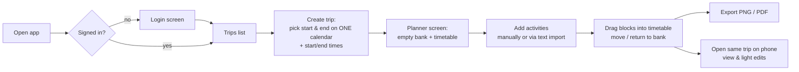
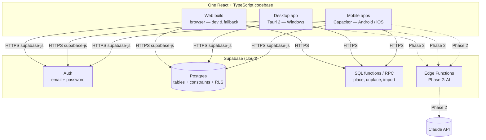
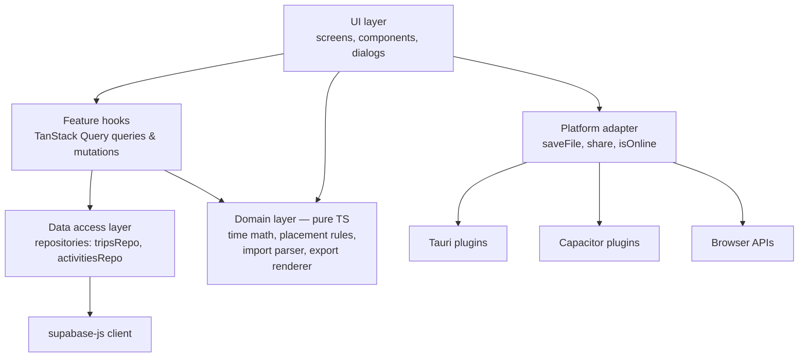
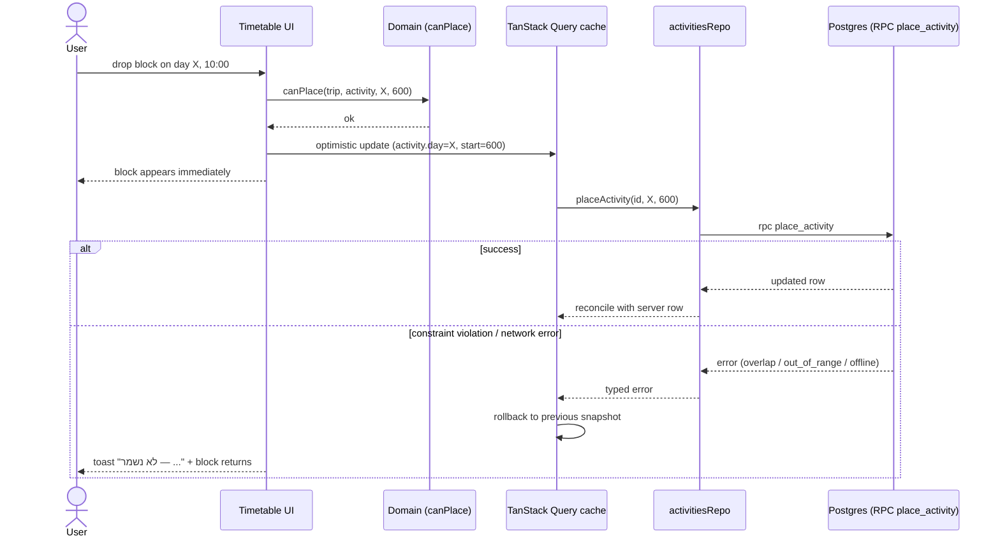
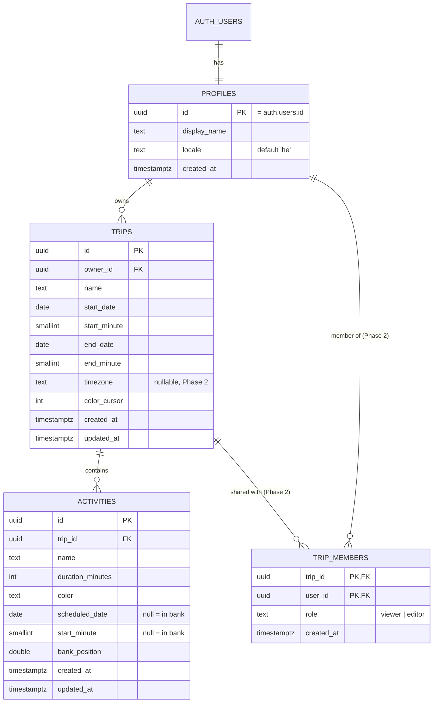
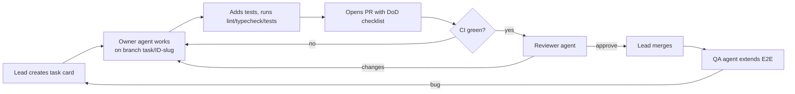

# Trip Planner — Project Plan

| | |
|---|---|
| **Status** | Approved direction, ready for implementation |
| **Version** | 1.2 — 2026-11-12 (cloud DB confirmed, `dev` project created, iPhone via PWA, repo moved to `C:\dev\trip-planner`) |
| **Repository** | GitHub `MoranK67/TripPlanner`, local clone `C:\dev\trip-planner` |
| **Hebrew translation** | [`PROJECT_PLAN.he.md`](PROJECT_PLAN.he.md) — the English version is authoritative if they differ |
| **Owner** | Product owner (single user, builds with AI coding agents) |
| **Reference prototype** | [`prototype/index.html`](prototype/index.html) — working single-file prototype; the UX source of truth for look & feel |

**Legend used throughout this document**

- **[C]** = *Confirmed requirement* — explicitly requested or approved by the product owner.
- **[R]** = *Recommendation* — architect's proposal; may be changed without re-opening product scope.
- **[A]** = *Assumption* — documented in [§12](#12-open-questions-and-assumptions); must be revisited if wrong.

---

## Table of contents

1. [Project overview and goals](#1-project-overview-and-goals)
2. [Functional requirements](#2-functional-requirements)
3. [Non-functional requirements](#3-non-functional-requirements)
4. [System architecture](#4-system-architecture)
5. [Technology stack](#5-technology-stack)
6. [Database design](#6-database-design)
7. [API and integration design](#7-api-and-integration-design)
8. [Feature breakdown](#8-feature-breakdown)
9. [Development roadmap](#9-development-roadmap)
10. [Multi-agent architecture](#10-multi-agent-architecture)
11. [Risks and technical challenges](#11-risks-and-technical-challenges)
12. [Open questions and assumptions](#12-open-questions-and-assumptions)

---

## 1. Project overview and goals

### 1.1 The product in one sentence

A visual trip planner in which a traveler defines the trip's time window, builds a bank of colored "activity blocks" whose height reflects their duration, and drags them into a half-hour timetable covering every day of the trip.

### 1.2 What makes it different

Most travel planners (TripIt, Wanderlog, Google Travel) are lists + maps. This product is a **timetable**: the core value is *seeing* how the days fill up and rearranging time physically. Every scope decision must protect that core interaction. Features that do not strengthen "planning time visually" are deferred.

### 1.3 Goals

| # | Goal | Type |
|---|---|---|
| G1 | Plan a multi-day trip visually: trip window → activity bank → drag into timetable. | [C] |
| G2 | Data lives in a real database, not in the browser, and is the same on every device. | [C] |
| G3 | Available as a desktop app (Windows), a mobile app (Android), and on iPhone as a free installable web app (PWA). A native iOS app is deferred — the architecture keeps it possible. | [C] |
| G4 | Single user now; architecture ready for multiple users later without data-model rewrites. | [C] |
| G5 | Hebrew, RTL, soft pastel visual identity of the prototype. | [C] |
| G6 | Maintainable by one non-specialist owner working with AI agents: few technologies, clear module boundaries, strong tests. | [R] |

### 1.4 Explicit non-goals (for now)

| Not included | Reason / when |
|---|---|
| Information about places (search, addresses, hours, photos, maps) | [C] Excluded by owner. Future. |
| Activities crossing midnight / multi-day items (flights, hotels) | [C] Phase 2. |
| AI features | [C] Phase 2. AI will *assist* (suggest, arrange), never plan the trip on its own. |
| Multiple users, sign-up, sharing | [C] Phase 2. Schema is prepared now. |
| UI languages other than Hebrew | [C] Later; i18n infrastructure is built in from day one [R]. |
| Bookings, budget, packing lists, weather | Future. |

### 1.5 Primary user journey (MVP)



### 1.6 Use cases

| ID | Use case |
|---|---|
| UC1 | Planning a city break (2–5 days) at a desk, refining over several sessions. |
| UC2 | Pasting a list of attractions (from notes, Excel, or an AI chat) to fill the bank in one go. |
| UC3 | Re-planning during the trip from the phone (move tomorrow's museum to the afternoon). |
| UC4 | Exporting the plan as an image/PDF to send to travel companions. |
| UC5 | Keeping several trips (past, current, future) and switching between them. |

---

## 2. Functional requirements

Priority uses MoSCoW: **Must** (MVP blocker), **Should** (MVP, can slip to just after), **Could** (Phase 2 candidate).

### 2.1 Account & access

| ID | Requirement | Priority | Source |
|---|---|---|---|
| FR-1.1 | The user signs in with email + password. | Must | [R] (needed for cloud DB, G2/G4) |
| FR-1.2 | Session persists across app restarts on each device. | Must | [R] |
| FR-1.3 | Public sign-up is disabled in the MVP; the single account is created by the owner. | Must | [R] from [C] single user |
| FR-1.4 | The user can sign out. | Must | [R] |
| FR-1.5 | Password reset by email. | Should | [R] |

### 2.2 Trips

| ID | Requirement | Priority | Source |
|---|---|---|---|
| FR-2.1 | The user can create multiple trips and switch between them. | Must | [C] |
| FR-2.2 | Trip has a name (1–50 chars; default "הטיול שלי"). | Must | [C] |
| FR-2.3 | Trip dates are chosen on **one calendar**: first click = start day, second click = end day; the range is highlighted. Not two separate date pickers. | Must | [C] |
| FR-2.4 | Start time and end time are chosen alongside the calendar, in 30-minute steps. Start: 00:00–23:30; end: 00:30–24:00. | Must | [C] |
| FR-2.5 | End must be after start; maximum trip length 90 days. | Must | [R] |
| FR-2.6 | Editing a trip's window moves any activities now outside the window back to the bank and reports how many were moved. | Must | [C] (prototype behavior) |
| FR-2.7 | Deleting a trip requires confirmation in a dialog and deletes its activities. | Must | [C] |
| FR-2.8 | Trips list shows name, date range and number of days; sorted by start date. | Must | [R] |

### 2.3 Activity bank

| ID | Requirement | Priority | Source |
|---|---|---|---|
| FR-3.1 | The user can add any number of activities: name (1–60 chars), duration (30 min – 24 h, 30-minute steps), color. | Must | [C] |
| FR-3.2 | Colors come from a fixed pastel palette of 10; new activities get the next color automatically; the user may change it. | Must | [C] |
| FR-3.3 | Blocks are colored and their **height is proportional to duration**, using the same scale in the bank and the timetable. | Must | [C] |
| FR-3.4 | Deleting an activity (from bank or timetable) always asks "are you sure?" in a small dialog. | Must | [C] |
| FR-3.5 | Clicking/tapping a block opens an edit dialog (name, duration, color; "return to bank" if placed). | Must | [C] (prototype) |
| FR-3.6 | If an edited duration no longer fits its timetable position, the activity returns to the bank with a notice. | Must | [C] (prototype) |
| FR-3.7 | Placing an activity in the timetable **removes it from the bank**; returning it appends it to the end of the bank. | Must | [C] |

### 2.4 Timetable

| ID | Requirement | Priority | Source |
|---|---|---|---|
| FR-4.1 | The timetable has one column per trip day and rows for every 30 minutes from 00:00 to 24:00. | Must | [C] |
| FR-4.2 | Slots before the trip start (first day) and after the trip end (last day) are visibly disabled and cannot receive activities. | Must | [C] |
| FR-4.3 | Day headers show weekday (Hebrew), date and "day N". | Must | [C] (prototype) |
| FR-4.4 | On opening a trip the view scrolls to the trip's start time. | Should | [R] |
| FR-4.5 | Placed blocks show name and time range. | Must | [C] |
| FR-4.6 | Activities cannot overlap and cannot cross midnight (MVP). | Must | [C]/[R] |

### 2.5 Placement interactions

| ID | Requirement | Priority | Source |
|---|---|---|---|
| FR-5.1 | **Desktop:** drag a block from the bank into the timetable; drag within the timetable to move; drag back to the bank to unplace. | Must | [C] |
| FR-5.2 | While dragging, a preview shows the target slot: green = valid, red = invalid; invalid drops are rejected with a notice. | Must | [C] (prototype) |
| FR-5.3 | Snapping to 30-minute slots. | Must | [C] |
| FR-5.4 | Auto-scroll the timetable when dragging near its edges. | Must | [R] |
| FR-5.5 | **Mobile:** a tap-to-place mode (tap block → tap free slot) in addition to drag, because drag across a small screen is unreliable. | Must | [R] |
| FR-5.6 | Keyboard alternative for placement (accessibility). | Should | [R] |
| FR-5.7 | Changes are shown immediately (optimistic) and rolled back with an error notice if saving fails. | Must | [R] |

### 2.6 Text import

| ID | Requirement | Priority | Source |
|---|---|---|---|
| FR-6.1 | An "Import" dialog accepts **pasted text only** (no file upload). | Must | [C] |
| FR-6.2 | Supported formats: one per line `name; duration`; `{name;duration},{name;duration}`; two tab-separated columns (pasted from Excel). | Must | [C] |
| FR-6.3 | Duration formats: `3`, `1.5`, `1,5`, `2:30`, `40 דקות`, `2 שעות`, `שעתיים`, `2 שעות וחצי`, `שעה וחצי`, `חצי שעה`. Rounded to nearest 30 min (flagged "rounded"). | Must | [C] (prototype) |
| FR-6.4 | Live preview: valid rows (with assigned color and parsed duration) and invalid rows (with reason). Only valid rows are imported. | Must | [C] |
| FR-6.5 | Max 200 rows per import. | Must | [R] |

### 2.7 Export

| ID | Requirement | Priority | Source |
|---|---|---|---|
| FR-7.1 | Export the trip's timetable as PNG. | Must | [C] |
| FR-7.2 | Export as PDF (A4, up to 7 days per page, orientation chosen per page). | Must | [C] |
| FR-7.3 | Hour range option: "relevant hours" (08:00–22:00 expanded to include all placed activities) or "full day". | Must | [C] (prototype) |
| FR-7.4 | Export works offline (no CDN dependency). | Must | [R] |
| FR-7.5 | On mobile, export opens the native share sheet; on desktop, a "save as" dialog. | Must | [R] |

### 2.8 Data portability & offline

| ID | Requirement | Priority | Source |
|---|---|---|---|
| FR-8.1 | Import trips from the prototype (via a JSON backup file produced by a small addition to the prototype). | Must | [C] |
| FR-8.2 | Export / import a full JSON backup of all the user's trips. | Should | [R] |
| FR-8.3 | The most recently viewed trips are readable offline (read-only) on each device; editing requires a connection and the UI says so. | Should | [R] |

### 2.9 Language & presentation

| ID | Requirement | Priority | Source |
|---|---|---|---|
| FR-9.1 | All UI in Hebrew, RTL. | Must | [C] |
| FR-9.2 | All UI strings live in translation files from day one, so a second language can be added without code changes. | Must | [R] from [C] |
| FR-9.3 | Pastel visual identity of the prototype (palette, rounded shapes, Rubik font). | Must | [C] |

---

## 3. Non-functional requirements

| ID | Category | Requirement | Measure / acceptance |
|---|---|---|---|
| NFR-1 | Reliability | No silent data loss. Every change is persisted or the user is told it failed. | All mutations have error handling + rollback; tested in E2E with simulated network failure. |
| NFR-2 | Data integrity | The database itself rejects invalid states (overlaps, out-of-range, bad durations), not only the UI. | DB constraints + tests (§6.4). |
| NFR-3 | Performance | Planner usable for a 30-day trip at 60 fps while dragging; 90-day trip remains usable. | Manual profiling on a mid-range laptop and phone. |
| NFR-4 | Performance | Cold start to trips list < 3 s on a normal connection. | Measured on desktop app and Android. |
| NFR-5 | Security | Each user can only read/write their own data (enforced in DB). No secrets in the client. | RLS policies + automated RLS tests. |
| NFR-6 | Privacy | Data stored only in the project's own Supabase instance (EU region [R]); no analytics/third-party trackers in MVP. | Config review. |
| NFR-7 | Accessibility | Text contrast ≥ WCAG AA on all pastel colors; all actions reachable without drag; focus visible; dialogs trap focus and close on Esc. | Axe check in E2E + manual. |
| NFR-8 | Usability | Desktop-first planning; phone fully usable for viewing and light edits. Minimum supported width 360 px. | Manual test on phone sizes. |
| NFR-9 | Portability | One UI codebase builds web, Windows, Android (and iOS later). | CI builds web, Windows and Android. |
| NFR-10 | Maintainability | TypeScript strict; lint + format enforced; domain logic ≥ 90 % unit test coverage; feature modules don't import each other's internals. | CI gates. |
| NFR-11 | Extensibility | Adding users, sharing, multi-day items and a second language requires additive migrations, not rewrites. | Design reviews against §6 and §8. |
| NFR-12 | Cost | MVP runs on free tiers (except optional Apple developer account). | Monthly bill = $0 (+$99/yr Apple if iOS). |

---

## 4. System architecture

### 4.1 Key decision: cloud database with thin clients [R]

The owner wants (a) data not in the browser, (b) the same data on desktop and phone, (c) users later. A local database per device would split the data between devices; syncing local databases is complex (conflict resolution) and disproportionate for this product. **Therefore: one cloud database (Supabase Postgres), accessed directly by every client.**

| Option considered | Verdict |
|---|---|
| Local SQLite per device | ✗ Data differs per device; violates G2. |
| Local-first with sync engine (e.g., PowerSync, ElectricSQL) | ✗ for MVP — powerful but adds a moving part and conflict logic. Revisit if full offline editing becomes a requirement. |
| Custom backend (Node/Express + Postgres) | ✗ for MVP — would require building auth, hosting, security ourselves. Nothing in the MVP needs custom server logic beyond what Postgres functions provide. |
| **Supabase (Postgres + Auth + RLS + Edge Functions)** | ✓ Real relational DB, built-in auth, row-level security, free tier, standard Postgres (low lock-in). Edge Functions available for Phase 2 AI. |

### 4.2 High-level architecture



### 4.3 Frontend architecture (layered)



| Layer | Responsibility | Rules |
|---|---|---|
| **Domain** (`src/domain`) | Pure functions: minute/slot math, `canPlace`, day ranges, duration parsing, import parsing, fitted export range, export canvas drawing. | No React, no Supabase, no I/O. 100 % deterministic, heavily unit-tested. Shared by UI (instant validation) and tests. |
| **Data access** (`src/data`) | Repositories wrapping Supabase calls; map DB rows ⇄ domain types; normalize errors. | The *only* place that imports `supabase-js`. Swapping backend later = rewriting this folder only. |
| **Feature hooks** (`src/features/*/hooks`) | TanStack Query queries/mutations, optimistic updates, cache invalidation. | No direct Supabase calls. |
| **UI** (`src/features/*/components`, `src/components/ui`) | Rendering and interaction. | Business rules come from Domain, never re-implemented inline. |
| **Platform adapter** (`src/platform`) | One interface, three implementations (web/Tauri/Capacitor), chosen at startup. | Features never check the platform themselves. |

### 4.4 Data flow — placing an activity (optimistic)



### 4.5 Time model (critical design decision) [R]

| Decision | Detail | Why |
|---|---|---|
| Times are **floating local times** of the destination | Stored as `date` + `minute of day` (integer), no time zone. | Matches how travelers think ("museum at 10:00 in Rome"); avoids DST/time-zone bugs; MVP has no cross-zone items. |
| Minutes, not slot indexes | `start_minute` ∈ {0, 30, …, 1410}; `duration_minutes` multiple of 30. | Allows changing granularity (e.g., 15 min) later without a data migration. Slot = UI concept. |
| Trip end uses `end_minute` up to 1440 | "24:00" = end of that day. | Avoids the "00:00 next day" ambiguity. |
| `trips.timezone` column reserved (nullable) | Unused in MVP. | Needed for Phase 2 flights/multi-day items. |

### 4.6 Error handling, logging, security

| Concern | Approach |
|---|---|
| **Error taxonomy** | Data layer maps errors to a small set: `network`, `auth_expired`, `conflict_overlap`, `out_of_range`, `validation`, `not_found`, `unknown`. UI shows a Hebrew message per type. |
| **User-facing errors** | Toasts for failed mutations (with rollback); inline messages in forms; full-screen error boundary with "reload" for crashes. |
| **Auth expiry** | supabase-js auto-refreshes tokens; on `auth_expired` the app routes to login and preserves the current trip id. |
| **Logging** | MVP: structured `console` logging behind a tiny `logger` module (levels; disabled in production except errors). Supabase dashboard logs for DB/API. Phase 2: Sentry free tier [R] if real users arrive. |
| **Security** | RLS on every table, deny-by-default; only the **publishable key** (`sb_publishable_…`, formerly "anon key") ships in the client; the **secret / service_role key** and the database password never leave the owner's machine/CI secrets and are never pasted into chats or committed; sign-ups disabled; all inputs validated client-side (zod) **and** by DB check constraints; React escaping prevents HTML injection; no `dangerouslySetInnerHTML`. |
| **Secrets** | `.env.local` (git-ignored) holds `VITE_SUPABASE_URL` + `VITE_SUPABASE_PUBLISHABLE_KEY`; `.env.example` (committed) documents them; CI secrets for deploy keys, Android signing. |
| **Supabase project security settings** (set at project creation [C]) | *Data API* enabled; *Automatically expose new tables* **disabled** → every migration must explicitly `GRANT` table privileges to the `authenticated` role (never to `anon`); *Automatic RLS* **enabled** as a safety net (migrations still enable RLS explicitly). |

### 4.7 Scalability & extensibility

- **Users**: every row is already owned (`owner_id`); RLS goes through one SQL helper `can_access_trip(trip_id, min_role)`. Sharing (Phase 2) changes that helper and adds `trip_members` — no table rewrites.
- **Multi-day items**: Phase 2 adds `end_date`/`end_minute` (or `start_at`/`end_at`) to `activities`; the overlap constraint is upgraded from per-day int ranges to a timestamp-range constraint. The domain layer isolates this change.
- **Load**: a single user generates trivially small load; Supabase free tier is sufficient by orders of magnitude.
- **Realtime** (Phase 2): Supabase Realtime subscription on `activities` to update other open devices live; MVP uses refetch-on-focus.

---

## 5. Technology stack

### 5.1 Summary

| Area | Choice [R] | Alternatives considered | Why this choice / trade-off |
|---|---|---|---|
| Language | **TypeScript (strict)** | JavaScript | Types are the contract between AI agents and modules; catches errors early. |
| UI framework | **React 18** | Svelte, Vue, Solid | Largest ecosystem (dnd, date pickers), best AI-agent familiarity. Trade-off: more boilerplate than Svelte. |
| Build tool | **Vite** | Next.js | App is a client-side SPA packaged into native shells; Next.js server features are unused and complicate Tauri/Capacitor. |
| Routing | **React Router** | TanStack Router | Simple, well known; only ~4 routes. |
| Server state | **TanStack Query** | Redux Toolkit Query, plain fetch | Caching, optimistic updates, rollback, refetch-on-focus, offline persistence — all needed, all built in. |
| Local UI state | **React state + small Zustand store** for drag/selection state | Redux | Minimal; avoids prop drilling during drag. |
| Drag & drop | **dnd-kit** | Custom pointer code (prototype), react-dnd | Mouse + touch + keyboard sensors, accessibility, auto-scroll. Trade-off: must verify RTL coordinate handling (prototype logic is the fallback). |
| Date range calendar | **react-day-picker** (range mode, `he` locale, RTL) | Custom calendar, MUI pickers | Exactly matches FR-2.3 (one calendar, start + end), lightweight, accessible. |
| Dates | **date-fns** + `he` locale | Day.js, Luxon | Tree-shakable, pure functions; Luxon only needed once time zones arrive (Phase 2). |
| Validation | **zod** | yup | Shared schemas for forms and repository input. |
| Styling | **Tailwind CSS** with design tokens from the prototype (CSS variables) | CSS Modules, styled-components | Logical properties (`ms-`, `pe-`) make RTL natural; fast for agents. Trade-off: long class lists — mitigated by `components/ui`. |
| i18n | **i18next + react-i18next**, Hebrew only | Hard-coded strings | Cheap now, expensive to retrofit (FR-9.2). |
| PDF | **jsPDF** (bundled via npm) | pdf-lib, print-to-PDF | Proven in prototype; bundled → works offline. |
| Image export | **Canvas renderer** ported from prototype | html2canvas | Crisp, renders all days (not just the visible scroll area), full control of RTL text. |
| Backend | **Supabase**: Postgres 15+, Auth, RLS, RPC (SQL functions); Edge Functions in Phase 2 | Firebase, custom Node API | Relational data with constraints (overlap prevention) fits Postgres far better than Firestore; no server to operate. Trade-off: vendor dependence — mitigated by standard Postgres + data-access layer. |
| DB migrations | **Supabase CLI** migrations in git | Dashboard edits | Reproducible, reviewable schema. |
| Desktop shell | **Tauri 2** (Windows) | Electron | ~10 MB vs ~150 MB installer, lower memory. Trade-off: requires Rust toolchain for builds. |
| Mobile shell | **Capacitor** (Android + iOS) | Tauri 2 mobile, React Native | Reuses the same web build unchanged; mature plugins (Share, Filesystem, Preferences); large documentation base. React Native would require a second UI codebase. Tauri mobile is viable but less mature for store publishing. |
| Unit / component tests | **Vitest + Testing Library** | Jest | Native to Vite, fast. |
| E2E tests | **Playwright** (web build, desktop + mobile viewports) | Cypress | Real drag-and-drop & touch emulation, parallel, free. |
| DB tests | **pgTAP** via Supabase CLI, or SQL test scripts run against the `dev` project | — | Proves RLS and constraints (NFR-2, NFR-5). |
| Lint / format | **ESLint + Prettier**, `import/no-restricted-paths` for module boundaries | Biome | Boundary rules enforce the architecture. |
| Package manager | **npm** (changed from pnpm — [ADR-001](docs/decisions/001-npm-instead-of-pnpm.md)) | pnpm | Ships with Node; one tool fewer for the owner. |
| Source control & CI | **GitHub + GitHub Actions** | GitLab | Free private repos, tauri-action, macOS runners for iOS. |
| Web hosting (**required** — serves the iPhone PWA) | **Cloudflare Pages** (free) | Netlify, Vercel | Hosts the web build as an installable PWA for iPhone (free alternative to a native iOS app), plus "open in any browser" and a preview per PR. |
| PWA support | **vite-plugin-pwa** (manifest, icons, service worker) | Hand-written service worker | Standard, low-effort; also provides the offline read cache shell. |
| AI (Phase 2) | **Claude API** called from a **Supabase Edge Function** (API key server-side only) | Calling AI directly from the client | Never expose AI keys in apps; central place for prompt, limits and cost control. |

### 5.2 What we deliberately do **not** use

- No custom backend server, no Docker requirement for daily work, no GraphQL, no microservices, no Redux, no monorepo tooling (Nx/Turborepo). One app package + one `supabase/` folder is enough.

### 5.3 Testing strategy

| Level | Scope | Tooling | Gate |
|---|---|---|---|
| Domain unit tests | Time math, `canPlace`, day ranges, parsers, fitted range, export layout math | Vitest | ≥ 90 % coverage on `src/domain` |
| Component tests | Dialogs, forms, bank, block rendering (heights, colors), confirm flows | Vitest + Testing Library | Key components covered |
| Data layer tests | Repository mapping and error normalization (mocked client) | Vitest | All repos |
| DB tests | Constraints (overlap, bounds, durations), RLS isolation between two users, RPCs, trip-update trigger | pgTAP / SQL scripts on `dev` | All policies & RPCs |
| E2E | Golden paths: login → create trip → add/import → drag/place → move → unplace → delete (with confirm) → export; mobile tap-to-place; offline read | Playwright | Runs on every PR |
| Manual | Real devices: Windows app, Android phone, iPhone | Checklist per release | Before each release |

---

## 6. Database design

### 6.1 Entity-relationship diagram



### 6.2 Tables

#### `profiles`

| Column | Type | Constraints | Notes |
|---|---|---|---|
| `id` | uuid | PK, FK → `auth.users.id` ON DELETE CASCADE | Created by trigger on new auth user. |
| `display_name` | text | 1–60 chars, nullable | |
| `locale` | text | default `'he'`, check in (`'he'`) for MVP | Extended when languages are added. |
| `created_at` | timestamptz | default `now()` | |

#### `trips`

| Column | Type | Constraints | Notes |
|---|---|---|---|
| `id` | uuid | PK, default `gen_random_uuid()` | |
| `owner_id` | uuid | NOT NULL, FK → `profiles.id` ON DELETE CASCADE, default `auth.uid()` | |
| `name` | text | NOT NULL, `char_length` 1–50 | |
| `start_date` | date | NOT NULL | |
| `start_minute` | smallint | NOT NULL, 0–1410, `% 30 = 0` | |
| `end_date` | date | NOT NULL | |
| `end_minute` | smallint | NOT NULL, 30–1440, `% 30 = 0` | 1440 = 24:00 |
| `timezone` | text | nullable | Reserved for Phase 2. |
| `color_cursor` | int | NOT NULL default 0 | Index of the next palette color for new activities. |
| `created_at` / `updated_at` | timestamptz | default `now()`; `updated_at` maintained by trigger | |

Table-level checks:
- `(end_date, end_minute) > (start_date, start_minute)` (row comparison).
- `end_date - start_date <= 89` (max 90 days).

Index: `(owner_id, start_date)`.

#### `activities`

| Column | Type | Constraints | Notes |
|---|---|---|---|
| `id` | uuid | PK | |
| `trip_id` | uuid | NOT NULL, FK → `trips.id` ON DELETE CASCADE | |
| `name` | text | NOT NULL, 1–60 chars | |
| `duration_minutes` | int | NOT NULL, 30–1440, `% 30 = 0` | |
| `color` | text | NOT NULL, matches `^#[0-9A-Fa-f]{6}$` | Palette enforced in client; DB only checks format (palette may evolve). |
| `scheduled_date` | date | nullable | NULL ⇔ in bank |
| `start_minute` | smallint | nullable, 0–1410, `% 30 = 0` | |
| `bank_position` | double precision | NOT NULL | Order within the bank; fractional to allow future reordering without renumbering. |
| `created_at` / `updated_at` | timestamptz | | |

Table-level checks:
- `(scheduled_date IS NULL) = (start_minute IS NULL)` — both set or both empty.
- `start_minute + duration_minutes <= 1440` when scheduled — **no crossing midnight in MVP**.

**No-overlap constraint** (requires extension `btree_gist`):

```
EXCLUDE USING gist (
  trip_id WITH =,
  scheduled_date WITH =,
  int4range(start_minute, start_minute + duration_minutes) WITH &&
) WHERE (scheduled_date IS NOT NULL)
```

Indexes: `(trip_id, scheduled_date)`, `(trip_id, bank_position) WHERE scheduled_date IS NULL`.

#### `trip_members` *(Phase 2 — not created in MVP)*

| Column | Type | Constraints |
|---|---|---|
| `trip_id` | uuid | PK part, FK → trips ON DELETE CASCADE |
| `user_id` | uuid | PK part, FK → profiles ON DELETE CASCADE |
| `role` | text | `viewer` \| `editor` |
| `created_at` | timestamptz | |

### 6.3 Database functions and triggers

| Name | Kind | Purpose |
|---|---|---|
| `set_updated_at()` | trigger | Maintains `updated_at` on `trips`, `activities`. |
| `handle_new_user()` | trigger on `auth.users` insert | Creates `profiles` row. |
| `can_access_trip(trip_id uuid, min_role text)` | SQL function, `SECURITY DEFINER`, stable | MVP: `owner_id = auth.uid()`. Phase 2: also checks `trip_members`. **All RLS policies use this one function.** |
| `validate_activity_in_trip()` | trigger BEFORE INSERT/UPDATE on `activities` | If scheduled, verifies date is within trip dates and minute range within the trip's first/last-day bounds; raises `out_of_range`. |
| `unplace_out_of_range_activities()` | trigger AFTER UPDATE OF dates/minutes on `trips` | Moves activities outside the new window to the bank (appending `bank_position`). Guarantees FR-2.6 even if a client forgets. |
| `place_activity(activity_id, date, start_minute)` | RPC | Validates and sets placement atomically; returns the row; raises typed errors (`conflict_overlap`, `out_of_range`). |
| `unplace_activity(activity_id)` | RPC | Clears placement, sets `bank_position = max + 1`. |
| `import_activities(trip_id, items jsonb)` | RPC | Inserts up to 200 activities in one transaction, assigns colors from `color_cursor`, advances cursor. |
| `update_trip_window(trip_id, start_date, start_minute, end_date, end_minute, name)` | RPC | Updates trip and returns `{trip, moved_count}` so the UI can report FR-2.6. |

Errors raised by functions use stable codes in the message (`TP_OVERLAP`, `TP_OUT_OF_RANGE`, `TP_LIMIT`), which the data layer maps to the error taxonomy (§4.6).

### 6.4 Row-level security

| Table | SELECT | INSERT | UPDATE | DELETE |
|---|---|---|---|---|
| `profiles` | `id = auth.uid()` | via trigger only | `id = auth.uid()` | none (cascade from auth) |
| `trips` | `can_access_trip(id,'viewer')` | `owner_id = auth.uid()` | `can_access_trip(id,'editor')` | `owner_id = auth.uid()` |
| `activities` | `can_access_trip(trip_id,'viewer')` | `can_access_trip(trip_id,'editor')` | `can_access_trip(trip_id,'editor')` | `can_access_trip(trip_id,'editor')` |

RLS enabled and forced on all tables; anon role has no table grants. Because automatic table exposure is disabled in the project, each migration that creates a table also contains the explicit `GRANT SELECT, INSERT, UPDATE, DELETE … TO authenticated` (and `GRANT EXECUTE` on RPCs to `authenticated`).

### 6.5 Environments

| Environment | Purpose |
|---|---|
| `dev` Supabase project | Development, DB tests, E2E tests (seeded test users). |
| `dev` — **created 2026-11-12** | Project name `trip-planner-dev`, region Central EU (Frankfurt), ref `hnabofhgpefcjjzlxwbm`, URL `https://hnabofhgpefcjjzlxwbm.supabase.co`. Note: public sign-up is currently **enabled** by default — disable it in M1.8. |
| `prod` Supabase project (create in M11.2; free tier allows 2 projects) | Owner's real data. Migrations applied via CLI from `main` only. Daily automatic backups (free tier: verify retention; see §11). |

---

## 7. API and integration design

### 7.1 Principles

- Clients use **supabase-js** directly; there is no custom REST server.
- Simple reads/writes use the auto-generated PostgREST API (table operations).
- Operations with **business rules or multi-row effects** go through **RPCs** (§6.3) so rules live in one place and are atomic.
- TypeScript types for tables and RPCs are **generated** (`supabase gen types typescript`) into `src/data/database.types.ts`; this file is the contract between the DB agent and the frontend agents.

### 7.2 Repository interface (frontend contract)

```text
authRepo
  signIn(email, password)              -> Session
  signOut()                            -> void
  getSession()                         -> Session | null
  onAuthChange(cb)                     -> unsubscribe
  requestPasswordReset(email)          -> void

tripsRepo
  list()                               -> TripSummary[]        (id, name, window, dayCount)
  get(tripId)                          -> TripWithActivities
  create(input: TripInput)             -> Trip
  updateWindow(tripId, input)          -> { trip, movedCount }  (RPC update_trip_window)
  delete(tripId)                       -> void

activitiesRepo
  create(tripId, input: ActivityInput) -> Activity
  update(id, patch: {name?, duration?, color?}) -> { activity, returnedToBank: boolean }
  delete(id)                           -> void
  place(id, date, startMinute)         -> Activity              (RPC place_activity)
  unplace(id)                          -> Activity              (RPC unplace_activity)
  importMany(tripId, items[])          -> Activity[]            (RPC import_activities)

backupRepo
  exportAll()                          -> BackupJson
  importAll(json, mode: 'add')         -> { trips: n, activities: m }
```

All functions throw `AppError { kind, message, cause }` (§4.6).

### 7.3 Domain types (shared)

```text
Minute       = integer 0..1440, multiple of 30
TripWindow   = { startDate: 'YYYY-MM-DD', startMinute, endDate, endMinute }
Trip         = { id, name, window: TripWindow, colorCursor }
Activity     = { id, tripId, name, durationMinutes, color,
                 placement: null | { date, startMinute }, bankPosition }
ImportRow    = { ok: true, name, durationMinutes, rounded } | { ok: false, raw, reason }
```

### 7.4 Platform adapter interface

```text
platform.saveFile(blob, suggestedName, mime) -> 'saved' | 'shared' | 'cancelled'
platform.isOnline()                          -> boolean (+ subscribe)
platform.kind                                -> 'web' | 'desktop' | 'android' | 'ios'
```

| Implementation | saveFile |
|---|---|
| Web | `<a download>` |
| Tauri | `@tauri-apps/plugin-dialog` save dialog + `plugin-fs` write |
| Capacitor | `@capacitor/filesystem` write to cache + `@capacitor/share` share sheet |

### 7.5 External integrations

| Integration | Phase | Notes |
|---|---|---|
| Supabase Auth / Postgres | MVP | Core. |
| Google Fonts (Rubik) | MVP → **bundled** | Font files are bundled into the app (offline, privacy), not loaded from Google at runtime [R]. |
| jsPDF | MVP | npm dependency, bundled. |
| Claude API via Edge Function | Phase 2 | `POST /functions/v1/ai-suggest` `{tripId, destination, prompt}` → suggested activities (name + duration) shown in the import-preview UI so the user approves before anything is added. Rate-limited per user; key in Edge Function secrets. |
| Places/maps APIs | Future | Excluded by owner [C]. |

---

## 8. Feature breakdown

Complexity: **S** (≤ 1 day for an agent), **M** (1–3 days), **L** (3–6 days), **XL** (> 6 days / high risk).

### 8.1 MVP

| ID | Feature | Purpose | Main functionality | Depends on | APIs / services | Complexity |
|---|---|---|---|---|---|---|
| F0 | Project foundation | Working skeleton every agent builds on | Repo, tooling, CI, env, design tokens, i18n setup, routing, error boundary | — | GitHub, Supabase projects | M |
| F1 | Database & security | Single source of truth with integrity | Schema, constraints, triggers, RPCs, RLS, generated types, DB tests | F0 | Supabase CLI | L |
| F2 | Domain core | Shared, tested business rules | Time math, `canPlace`, ranges, duration & import parsers, fitted export range | F0 | — | M |
| F3 | Auth | Protect data, enable sync | Login, session persistence, sign out, reset password, route guard | F1 | Supabase Auth | S |
| F4 | Design system | Consistent pastel RTL UI | Buttons, inputs, Modal, ConfirmDialog, Toast, ColorSwatches, Block component, layout | F0 | — | M |
| F5 | Trip management | Create & manage trips | Trips list, create/edit dialog with **single range calendar + times**, delete with confirm, switcher | F1, F2, F3, F4 | react-day-picker | M |
| F6 | Activity bank | Collect activities | Add/edit/delete (confirm), auto-color, proportional height, bank ordering | F1, F2, F4, F5 | — | M |
| F7 | Timetable view | See the plan | Day columns, 48 rows, disabled slots, sticky headers/time column, placed blocks, scroll to start | F2, F4, F5 | — | M |
| F8 | Placement interactions | The core interaction | Drag bank→grid, grid→grid, grid→bank; preview valid/invalid; auto-scroll; optimistic + rollback; keyboard alternative | F6, F7 | dnd-kit, RPCs | **XL** |
| F9 | Mobile planner UX | Usable on phones | Single-day view with day tabs, bank as bottom sheet, tap-to-place | F8 | — | L |
| F10 | Text import | Fast bank filling | Paste dialog, live preview, bulk insert via RPC | F2, F6 | RPC `import_activities` | S |
| F11 | Export PNG/PDF | Share the plan | Canvas renderer (port), PDF pagination, hour-range option, platform save/share | F2, F7, F14 | jsPDF, platform adapter | M |
| F12 | Data migration & backup | Keep prototype data; owner-controlled backups | "Export backup" button added to prototype; JSON import; full JSON export | F5, F6 | — | S |
| F13 | Offline read cache | View plan abroad without data | Persist query cache to device storage; offline banner; disable editing when offline | F5–F7 | TanStack Query persister | S |
| F14 | Platform adapter | Native save/share/online | Web/Tauri/Capacitor implementations | F0 | Tauri & Capacitor plugins | S |
| F15 | Desktop app | Windows app | Tauri 2 shell, icons, installer, CI build | F5–F14 | Tauri, tauri-action | M |
| F16 | Android app | Android app | Capacitor project, icons/splash, signed APK/AAB, CI build | F9, F14 | Capacitor, Android SDK | M |
| F17 | Native iOS app — **deferred** (not required for now [C]) | iPhone app | Capacitor iOS project, signing, TestFlight | F16 | Xcode (Mac), Apple Developer account ($99/yr) | L |
| F18 | **iPhone via PWA (free)** [C] | Use the app on iPhone at no cost | Web build hosted on Cloudflare Pages; web manifest, icons, splash, standalone display, safe-area handling; "Add to Home Screen" guide in Hebrew | F9, F13 | vite-plugin-pwa, Cloudflare Pages | S–M |

### 8.2 Phase 2 (important enhancements)

| ID | Feature | Purpose | Depends on | Complexity |
|---|---|---|---|---|
| P2-1 | Multi-day & overnight activities (flights, hotels, night trains) | Real-world itineraries [C] | F1 schema migration, F7, F8 | XL |
| P2-2 | AI assistant: suggest activities for a destination; "arrange my day"; free-text to activities — always previewed and approved by the user [C] | Faster planning | Edge Function, F10 preview UI | L |
| P2-3 | Multiple users & sign-up [C] | Open the app to others | F3, RLS | M |
| P2-4 | Sharing: read-only link, then editor/viewer members | Travel companions | P2-3, `trip_members` | L |
| P2-5 | Realtime updates across open devices | No stale screens | F1 | S |
| P2-6 | Second UI language (English) with RTL/LTR switching | International use | i18n (F0) | M |
| P2-7 | Notes and links per activity | Practical details | F6 | S |
| P2-8 | Undo / redo of placement actions | Safety while rearranging | F8 | M |
| P2-9 | Duplicate activity / duplicate trip | Recurring items (lunch every day) | F6 | S |
| P2-10 | Calendar export (.ics) | Put plan in Google/Apple calendar | F2 | S |
| P2-11 | Manual reorder & filtering of the bank | Large banks | F6 | S |

### 8.3 Future improvements (optional)

Map view & place search · travel time between activities · opening hours validation · budget & expenses · packing list · weather per day · booking import from email · full offline editing with sync · collaborative live editing · templates ("3 days in Rome").

---

## 9. Development roadmap

### 9.1 Milestone overview

```mermaid
gantt
    dateFormat  X
    axisFormat  M%s
    section Foundation
    M0 Foundation            :m0, 0, 1
    section Core (parallel)
    M1 Database & auth       :m1, after m0, 2
    M2 Domain core           :m2, after m0, 2
    M3 Design system & shell :m3, after m0, 2
    section Features
    M4 Trips & bank          :m4, after m1, 2
    M5 Timetable & placement :m5, after m4, 3
    M6 Import / export / backup :m6, after m4, 2
    M7 Mobile UX & offline   :m7, after m5, 2
    section Platforms
    M8 Desktop app           :m8, after m7, 1
    M9 Android app           :m9, after m7, 1
    M11 Hardening & release  :m11, after m9, 1
    section Deferred
    M10 iOS app (later)      :m10, after m11, 1
```



*(Bars show order and parallelism, not calendar weeks.)*

Implementation order rationale: **contracts first** (DB schema + generated types, domain types, UI primitives) so later features integrate against stable interfaces; **web first**, native shells last, because shells are thin wrappers and every feature is testable in the browser; the riskiest feature (placement, M5) starts as soon as its dependencies exist.

Each milestone ends with a **demo to the owner** (human checkpoint) before the next milestone's dependent work merges.

### 9.2 Tasks

Priority: P0 = MVP blocker, P1 = MVP should-have, P2 = can slip.

#### M0 — Foundation

> **Status 2026-11-12:** M0.1–M0.5, M0.7, M0.8 done (Vite 8 + React 18 + TS strict, Tailwind 4 tokens, i18n, ESLint boundaries, Vitest, CI, app shell with server-status check). The prototype moved to `prototype/index.html`. **Remaining:** M0.6 Supabase CLI link (needs the DB password, entered locally by the owner) — can be done at the start of M1.

| ID | Task | Expected outcome | Depends on | Pri | Cx | Modules |
|---|---|---|---|---|---|---|
| M0.1 | Create Git repo (outside OneDrive, see §11), GitHub remote, branch protection on `main` | Repo with README, `.gitignore`, PR template | — | P0 | S | repo |
| M0.2 | Scaffold Vite + React + TS (strict) + pnpm; ESLint, Prettier, import-boundary rules | `pnpm dev` runs; `pnpm lint` and `pnpm typecheck` pass | M0.1 | P0 | S | root |
| M0.3 | Folder structure (§10.4) with placeholder index files and boundary rules | Agents can work in parallel without conflicts | M0.2 | P0 | S | all |
| M0.4 | Tailwind + design tokens ported from prototype (palette, radii, shadows, Rubik bundled), RTL base | Tokens available as CSS vars & Tailwind theme | M0.2 | P0 | S | styles |
| M0.5 | i18n setup (i18next, `he.json`), `dir="rtl"` handling | All strings go through `t()` | M0.2 | P0 | S | i18n |
| M0.6 | ~~Create Supabase `dev` project~~ ✅ done (2026-11-12; `.env.local`, `.env.example`, `.gitignore` committed/created). Remaining: install Supabase CLI and link it to `dev` (requires DB password, entered locally by the owner, never shared). `prod` is created later (M11.2). | CLI linked; client connects | M0.1 | P0 | S | supabase, data |
| M0.7 | CI: install, lint, typecheck, unit tests on every PR | Green pipeline required to merge | M0.2 | P0 | S | .github |
| M0.8 | App shell: router (`/login`, `/trips`, `/trips/:id`), QueryClient, error boundary, toast host | Navigable empty app | M0.3–M0.5 | P0 | S | app |

#### M1 — Database & auth

| ID | Task | Expected outcome | Depends on | Pri | Cx | Modules |
|---|---|---|---|---|---|---|
| M1.1 | Migration: `profiles`, `trips`, `activities`, checks, indexes, `btree_gist`, exclusion constraint | Schema per §6.2 in `dev` | M0.6 | P0 | M | supabase |
| M1.2 | Triggers: `set_updated_at`, `handle_new_user`, `validate_activity_in_trip`, `unplace_out_of_range_activities` | Integrity enforced in DB | M1.1 | P0 | M | supabase |
| M1.3 | RLS: `can_access_trip` + policies per §6.4 | Isolation enforced | M1.1 | P0 | M | supabase |
| M1.4 | RPCs: `place_activity`, `unplace_activity`, `import_activities`, `update_trip_window` with typed error codes | Business operations atomic | M1.2 | P0 | M | supabase |
| M1.5 | DB tests: constraints, triggers, RPCs, RLS with two test users | Test suite green in CI against `dev` | M1.3, M1.4 | P0 | M | supabase/tests |
| M1.6 | Generate TS types; data-layer client + `AppError` mapping | `database.types.ts` committed; repos compile | M1.4 | P0 | S | data |
| M1.7 | Repositories: `authRepo`, `tripsRepo`, `activitiesRepo` (+ unit tests with mocked client) | Contract of §7.2 implemented | M1.6, M2.1 | P0 | M | data |
| M1.8 | Auth UI: login, sign-out, reset password, route guard, session persistence; disable sign-ups; create owner account in `prod` | Owner can log in | M1.7, M3.2 | P0 | S | features/auth |

#### M2 — Domain core

| ID | Task | Expected outcome | Depends on | Pri | Cx | Modules |
|---|---|---|---|---|---|---|
| M2.1 | Domain types (§7.3) and constants (`SLOT_MINUTES=30`, palette, limits) | Shared contract | M0.3 | P0 | S | domain |
| M2.2 | Time utilities: minute labels, trip days list, day bounds, Hebrew weekday/date formatting, duration labels (`שעתיים וחצי`) | Tested utilities | M2.1 | P0 | S | domain |
| M2.3 | Placement rules: `canPlace`, `fitsDay`, `findOverlaps`, `activitiesOutsideWindow` | Mirrors DB rules exactly; tests include edge cases (§9.4) | M2.1 | P0 | S | domain |
| M2.4 | Duration & import parser (port + harden prototype parser) with table-driven tests | All FR-6.2/6.3 formats pass | M2.1 | P0 | S | domain |
| M2.5 | Export layout model: fitted hour range, pagination (7 days/page), block geometry | Pure, tested layout math | M2.2 | P1 | S | domain |

#### M3 — Design system & shell

| ID | Task | Expected outcome | Depends on | Pri | Cx | Modules |
|---|---|---|---|---|---|---|
| M3.1 | UI primitives: Button variants, Input, Select, Field, Modal (focus trap, Esc), Toast | Storybook-free gallery page `/dev/ui` (dev only) | M0.4 | P0 | M | components/ui |
| M3.2 | `ConfirmDialog` (cancel is focused by default) | Used by every delete | M3.1 | P0 | S | components/ui |
| M3.3 | `ColorSwatches`, `ActivityBlock` (proportional height, short variant, delete ×, contrast-checked text) | Visual parity with prototype | M3.1, M2.1 | P0 | S | components/ui |
| M3.4 | Layout: header bar, responsive breakpoints (desktop ≥ 900 px, tablet, phone ≤ 600 px) | Shell matches prototype | M3.1 | P0 | S | app |

#### M4 — Trips & bank

| ID | Task | Expected outcome | Depends on | Pri | Cx | Modules |
|---|---|---|---|---|---|---|
| M4.1 | Trips list screen (cards, empty state, create button) | FR-2.1, 2.8 | M1.7, M3.4 | P0 | S | features/trips |
| M4.2 | Trip dialog: **single range calendar** (react-day-picker, `he`, RTL) + start/end time selects + validation | FR-2.3–2.5 | M4.1, M2.2 | P0 | M | features/trips |
| M4.3 | Edit trip window via RPC, toast with moved count; delete with confirm | FR-2.6, 2.7 | M4.2, M1.4 | P0 | S | features/trips |
| M4.4 | Bank panel: list, add/edit dialog, delete with confirm, auto color via `color_cursor` | FR-3.1–3.5 | M1.7, M3.3 | P0 | M | features/bank |
| M4.5 | E2E: trip CRUD + bank CRUD | Green in CI | M4.3, M4.4 | P0 | S | tests/e2e |

#### M5 — Timetable & placement (highest risk)

| ID | Task | Expected outcome | Depends on | Pri | Cx | Modules |
|---|---|---|---|---|---|---|
| M5.1 | **Spike**: dnd-kit in RTL scrollable grid with sticky headers, auto-scroll, touch sensor. Decide dnd-kit vs. port of prototype pointer engine | Written decision (ADR) within 1–2 days | M3.3 | P0 | M | features/schedule |
| M5.2 | Timetable rendering: columns, 48 rows (background-drawn lines for performance), disabled slots, sticky header/time column, scroll to start | FR-4.1–4.5 | M5.1, M4.2 | P0 | M | features/schedule |
| M5.3 | Drag bank→grid, grid→grid, grid→bank with snap and valid/invalid preview | FR-5.1–5.4 | M5.2 | P0 | L | features/schedule |
| M5.4 | Mutations with optimistic update + rollback + typed error toasts | FR-5.7, NFR-1 | M5.3, M1.7 | P0 | M | features/schedule |
| M5.5 | Edit-duration conflict → return to bank (FR-3.6); "return to bank" button | Prototype parity | M5.4 | P0 | S | features/bank, schedule |
| M5.6 | Keyboard placement (select block → choose day/time in dialog) | FR-5.6, accessibility | M5.4 | P1 | S | features/schedule |
| M5.7 | E2E: drag/place/move/unplace, invalid drop, network failure rollback | Green in CI | M5.4 | P0 | M | tests/e2e |
| M5.8 | Performance check: 30-day and 90-day trips | Meets NFR-3, fixes applied | M5.3 | P1 | S | features/schedule |

#### M6 — Import, export, backup

| ID | Task | Expected outcome | Depends on | Pri | Cx | Modules |
|---|---|---|---|---|---|---|
| M6.1 | Import dialog with live preview → RPC `import_activities` | FR-6.1–6.5 | M2.4, M4.4 | P0 | S | features/import |
| M6.2 | Platform adapter (web impl now; Tauri/Capacitor stubs) | `saveFile` works on web | M0.3 | P0 | S | platform |
| M6.3 | Canvas renderer port (uses domain layout model; bundled Rubik) + PNG export | FR-7.1, 7.3 | M2.5, M6.2 | P0 | M | features/export |
| M6.4 | PDF export with jsPDF (bundled), pagination | FR-7.2, 7.4 | M6.3 | P0 | S | features/export |
| M6.5 | Prototype change: "Export backup (JSON)" button in `index.html` | Owner can extract existing data | — | P0 | S | prototype |
| M6.6 | Backup import (prototype format + own format) and full JSON export | FR-8.1, 8.2 | M6.5, M1.7 | P0 | S | features/backup |

#### M7 — Mobile UX & offline

| ID | Task | Expected outcome | Depends on | Pri | Cx | Modules |
|---|---|---|---|---|---|---|
| M7.1 | Phone layout: single-day timetable with day tabs/swipe; bank as bottom sheet | Usable at 360 px | M5.4 | P0 | M | features/schedule |
| M7.2 | Tap-to-place mode (tap block → highlight valid slots → tap slot) | FR-5.5 | M7.1 | P0 | M | features/schedule |
| M7.3 | Offline: persist query cache, offline banner, disable mutations when offline | FR-8.3 | M5.4 | P1 | S | app, data |
| M7.4 | E2E on mobile viewport (touch) | Green in CI | M7.2 | P0 | S | tests/e2e |

#### M8–M10 — Native apps

| ID | Task | Expected outcome | Depends on | Pri | Cx | Modules |
|---|---|---|---|---|---|---|
| M8.1 | Tauri 2 shell: window config, icons, deep-link-free auth, Tauri `saveFile` | App runs on Windows | M6.2, M7 | P0 | M | src-tauri, platform |
| M8.2 | CI build of Windows installer (tauri-action), release artifact | Downloadable `.msi`/`.exe` | M8.1 | P0 | S | .github |
| M8.3 | PWA: vite-plugin-pwa manifest, icons, splash, standalone mode, iOS safe areas | Installable from Safari "Add to Home Screen" | M7 | P0 | S | app, platform |
| M8.4 | Deploy web build to Cloudflare Pages from `main` (+ preview per PR); Supabase auth redirect URLs updated | Public HTTPS URL; login works there | M8.3 | P0 | S | .github |
| M8.5 | Test on a real iPhone (Safari + installed PWA): login, view, tap-to-place, export via share sheet; Hebrew install guide | iPhone usable for free | M8.4 | P0 | S | QA, docs |
| M9.1 | Capacitor Android: project, icons/splash, status bar, back-button handling, Capacitor `saveFile`/share | App runs on Android phone | M7, M6.2 | P0 | M | android, platform |
| M9.2 | Signed release build (APK for side-loading; AAB if Play Store wanted) in CI | Installable APK | M9.1 | P0 | S | .github |
| M10.1 | *(Deferred)* Capacitor iOS project, safe areas, share sheet | App runs on iPhone | M9.1, Mac access | P2 | L | ios |
| M10.2 | *(Deferred)* Signing + TestFlight distribution (macOS CI runner) | Installed on owner's iPhone | M10.1, Apple account | P2 | M | .github |

> **M10 is deferred** by owner decision: iPhone support is not required for now. Nothing in M0–M9 may block a later iOS build (Capacitor keeps the same web code), but no iOS work is scheduled in the MVP.

#### M11 — Hardening & release

| ID | Task | Expected outcome | Depends on | Pri | Cx | Modules |
|---|---|---|---|---|---|---|
| M11.1 | Accessibility pass (axe, contrast on all palette colors, focus order) | NFR-7 met | M7 | P1 | S | all UI |
| M11.2 | Apply migrations to `prod`; import owner's prototype data | Real data in prod | M6.6 | P0 | S | supabase |
| M11.3 | Keep-alive / backup safeguard for free tier (§11 R3) | No paused project, weekly JSON backup | M11.2 | P0 | S | .github |
| M11.4 | Manual release checklist on Windows and Android | Signed-off MVP | all | P0 | S | — |
| M11.5 | User guide (Hebrew, 1 page) + developer README | Docs | all | P1 | S | docs |

### 9.3 Definition of Done (every task)

1. Code follows module boundaries (lint passes) and TypeScript strict passes.
2. Tests added/updated at the right level (§5.3); CI green.
3. All new UI strings in `he.json`; RTL verified.
4. No direct Supabase usage outside `src/data`; no business rule duplicated outside `src/domain` (except DB mirror).
5. PR description lists task ID, what changed, how it was tested, screenshots for UI.
6. Reviewed by the Reviewer agent; owner approves milestone demos.

### 9.4 Edge cases that must have tests

| Case | Expected behavior |
|---|---|
| Single-day trip (start and end same day) | Only slots between start and end are enabled. |
| Trip ends at 24:00 | Last day fully enabled; no "next day" column. |
| Activity of 24 h | Only placeable on a full day starting at 00:00. |
| Activity ending exactly at another's start | Allowed (half-open ranges). |
| Shrinking trip window | Out-of-range activities return to bank; count reported. |
| Lengthening an activity into a neighbor | Returns to bank with notice. |
| Two devices place different activities in the same slot | Second save fails with `conflict_overlap`; UI rolls back and refetches. |
| Network drops mid-drag | Rollback + "not saved" toast; nothing half-saved. |
| Session expired | Redirect to login; return to the same trip afterward. |
| Import with header row / empty lines / 201 rows | Header flagged invalid; empty lines ignored; > 200 rejected with message. |
| Names with emoji, mixed Hebrew/English, 60 chars | Rendered and exported correctly (bidi). |
| Leap day, month/year boundaries, 90-day trip | Correct day lists. |
| Deleting a trip with many activities | Cascade; single confirm dialog. |

---

## 10. Multi-agent architecture

This section defines how a **team of AI coding agents** builds the project (confirmed interpretation [C]). AI agents *inside* the product are Phase 2 (P2-2) and not covered here.

### 10.1 Roles

| Agent | Owns (write access) | Responsibilities | Inputs | Outputs |
|---|---|---|---|---|
| **Lead / Orchestrator** | `PROJECT_PLAN.md`, `docs/decisions/`, task board | Breaks milestones into task cards, assigns agents, resolves conflicts, guards scope, runs milestone demos with owner | This plan, owner feedback | Task cards, ADRs, merge decisions |
| **Database agent** | `supabase/` (migrations, functions, tests, seed) | Schema, constraints, RLS, RPCs, DB tests, type generation | §6, §7 | Migrations, `database.types.ts`, DB test suite |
| **Domain agent** | `src/domain/` | Pure business logic and its tests | §2, §4.5, §7.3, §9.4 | Tested functions & types |
| **Data agent** | `src/data/` | Repositories, error mapping, query persistence | Generated types, §7.2 | Repos + tests |
| **UI system agent** | `src/components/ui/`, `src/styles/`, `src/i18n/` | Design tokens, primitives, accessibility of primitives | Prototype, §3 NFR-7 | Component library |
| **Feature agent** | `src/features/{auth,trips,bank,import,export,backup}/`, `src/app/` | Screens and flows using domain + data + UI | Task cards | Features + component tests |
| **Scheduler agent** | `src/features/schedule/` | Timetable, drag & drop, tap-to-place, performance (the XL feature gets a dedicated owner) | M5/M7 tasks | Timetable feature + tests |
| **Platform agent** | `src/platform/`, `src-tauri/`, `android/`, `ios/`, release workflows | Native shells, adapters, builds, signing | M8–M10 | Installers / app builds |
| **QA agent** | `tests/e2e/`, test fixtures | E2E suites, edge-case matrix (§9.4), bug reports as task cards; does **not** fix product code | Plan + running app | E2E tests, bug cards |
| **Reviewer agent** | read-only | Reviews every PR against Definition of Done, boundaries, security rules | PR diff | Approve / change requests |

### 10.2 Contracts between agents

Agents integrate only through these **frozen contracts**. Changing one requires an ADR approved by the Lead.

| Contract | Producer | Consumers | Location |
|---|---|---|---|
| DB schema & RPC signatures | Database | Data | `supabase/migrations`, `src/data/database.types.ts` |
| Domain types & functions | Domain | Data, Feature, Scheduler, Export | `src/domain/index.ts` |
| Repository interface | Data | Feature, Scheduler | `src/data/index.ts` |
| UI primitives API | UI system | Feature, Scheduler | `src/components/ui/index.ts` |
| Platform adapter | Platform | Export, App | `src/platform/index.ts` |
| Error taxonomy | Data | everyone | `src/data/errors.ts` |

### 10.3 Workflow



**Task card template**

```text
ID / Title:
Milestone:
Owner agent:
Goal (user-visible outcome):
Requirements covered: FR-x.y, NFR-z
Inputs / contracts used:
Files allowed to change:
Acceptance criteria (testable):
Tests required:
Out of scope:
```

**Rules**

1. One owner per directory; an agent needing a change elsewhere opens a request card, it does not edit.
2. Contracts are built first (M1.1–M1.6, M2.1, M3.1) and frozen per milestone.
3. Small PRs (one task card each); no PR mixes contract changes with feature work.
4. Every decision that deviates from this plan is recorded as an ADR in `docs/decisions/NNN-title.md`.
5. The owner is the only authority on scope; agents never add features not in a task card.

### 10.4 Repository layout

```text
trip-planner/
├─ src/
│  ├─ app/                 routing, providers, layout, error boundary      (Feature)
│  ├─ components/ui/       primitives, ActivityBlock, ConfirmDialog        (UI system)
│  ├─ domain/              pure logic + tests                              (Domain)
│  ├─ data/                supabase client, repos, errors, types           (Data)
│  ├─ features/
│  │  ├─ auth/  trips/  bank/  import/  export/  backup/                   (Feature)
│  │  └─ schedule/         timetable & placement                           (Scheduler)
│  ├─ platform/            web / tauri / capacitor adapters                (Platform)
│  ├─ i18n/he.json                                                          (UI system)
│  └─ styles/tokens.css                                                     (UI system)
├─ supabase/migrations/ functions/ tests/ seed.sql                         (Database)
├─ tests/e2e/                                                               (QA)
├─ src-tauri/  android/  ios/                                              (Platform)
├─ docs/decisions/                                                          (Lead)
└─ PROJECT_PLAN.md
```

### 10.5 Parallelization map

| Phase | Agents working in parallel |
|---|---|
| After M0 | Database (M1.1–M1.5) ‖ Domain (M2) ‖ UI system (M3) |
| After contracts | Data (M1.6–M1.7) → Feature (M1.8, M4) ‖ Scheduler spike (M5.1) |
| Feature build | Scheduler (M5) ‖ Feature (M6) ‖ QA (E2E for M4) |
| Platforms | Platform (M8, M9) ‖ Scheduler (M7 mobile UX) ‖ QA (mobile E2E) |

---

## 11. Risks and technical challenges

| ID | Risk | Likelihood | Impact | Mitigation |
|---|---|---|---|---|
| R1 | **Drag & drop complexity** (RTL coordinates, scrolling grid with sticky elements, touch) | High | High | Early spike + ADR (M5.1); prototype pointer engine as proven fallback; tap-to-place on mobile; E2E coverage. |
| R2 | **Native iOS builds require macOS and an Apple Developer account ($99/yr)**; owner works on Windows | High | Low | iPhone served by the free PWA (F18); native iOS only if later needed, via GitHub Actions macOS runners + TestFlight (Q1). |
| R2b | **iOS PWA limitations**: Safari may clear a PWA's offline storage if unused for weeks; no App Store presence; file export goes through the share sheet | Medium | Low | Data lives in the cloud (only the offline cache can be cleared); test export on a real iPhone (M8.5). |
| R3 | **Supabase free projects pause after a period of inactivity** and have limited backup retention | Medium | High | Weekly scheduled CI job that pings the API and exports a JSON backup to a private location; upgrade to paid plan if needed. |
| R4 | Code repository inside a **OneDrive** folder (sync of `node_modules`, file locks during builds) | — | — | **Resolved** 2026-11-12: repo moved to `C:\dev\trip-planner`; GitHub is the backup. |
| R5 | Two native toolchains (Rust for Tauri, Android Studio / Xcode for Capacitor) are heavy for a non-specialist | Medium | Medium | Native builds run in CI; local native setup only for debugging; detailed setup docs by Platform agent. |
| R6 | Mobile usability of a 48-row timetable | High | Medium | Dedicated phone layout (M7) instead of shrinking the desktop grid. |
| R7 | Scope creep toward "comprehensive" planner | Medium | High | Non-goals list (§1.4); Lead enforces task cards; Phase 2 only after MVP sign-off. |
| R8 | Rule drift between client validation and DB constraints | Medium | Medium | DB is authoritative; domain tests and DB tests share the same edge-case table (§9.4). |
| R9 | Online-only editing frustrates use abroad | Medium | Medium | Offline read cache (M7.3); clear offline state; full offline editing evaluated after MVP. |
| R10 | Unsigned Windows installer triggers SmartScreen warnings | High | Low | Acceptable for personal use; code-signing certificate only if distributing publicly. |
| R11 | AI agents produce inconsistent code across modules | Medium | Medium | Frozen contracts, directory ownership, lint boundaries, Reviewer agent, small PRs. |
| R12 | Bidi text issues (Hebrew + numbers + English) in canvas export | Medium | Low | Export snapshot tests with mixed-language fixtures. |
| R13 | Supabase vendor lock-in | Low | Medium | Standard Postgres + SQL functions; all access isolated in `src/data`. |

---

## 12. Open questions and assumptions

### 12.1 Decisions confirmed by the owner

| # | Decision |
|---|---|
| D1 | Scope: trip planning only for now; more capabilities later. |
| D2 | Single user now; multiple users later. Data not stored in the browser. |
| D3 | Start and end are marked on one calendar, with start/end times. |
| D4 | No place information for now. |
| D5 | AI assists, never plans alone — Phase 2. |
| D6 | Multi-day / overnight activities — Phase 2. |
| D7 | Hebrew UI; additional UI languages later. |
| D8 | Keep the prototype's visual identity; import prototype trips. |
| D9 | "Multi-agent architecture" = AI agents that build the project. |
| D10 | Built by the owner with Claude and AI agents. |
| D11 | Apps for desktop and mobile. Android now; **iOS deferred** (not required for now, decided 2026-11-12). |
| D12 | A real database ("let's build a DB") — implemented as a cloud database to share data across devices. |
| D13 | **Cloud Supabase from the start** (no local Docker setup). `dev` project `trip-planner-dev` created in Central EU (Frankfurt). |
| D14 | **iPhone: free PWA first** (installable web app); native iOS app remains deferred. |
| D15 | Code repository: GitHub `MoranK67/TripPlanner`, local folder `C:\dev\trip-planner` (outside OneDrive). |
| D16 | Supabase security settings: Data API on, automatic table exposure off, automatic RLS on. |

### 12.2 Assumptions

| ID | Assumption | If wrong… |
|---|---|---|
| A1 | Desktop target is **Windows** only (no macOS/Linux desktop builds). | Tauri builds macOS/Linux too; add CI targets. |
| A2 | Internet is available when **editing**; offline is read-only. | Evaluate local-first sync engine (major change). |
| A3 | All times are the destination's local wall-clock time; no time zones in MVP. | Introduce `timezone` handling early (affects §4.5, §6). |
| A4 | Granularity stays 30 minutes in MVP. | Data model already supports other granularities. |
| A5 | Distribution is personal (side-loaded APK, TestFlight, direct installer), not public app stores. | Add store listing, privacy policy, signing certificates. |
| A6 | ~~Supabase region EU is acceptable.~~ Confirmed: Central EU (Frankfurt). | — |
| A7 | Free tiers are acceptable; Apple's $99/yr is the only potential cost. | Revisit hosting tier. |
| A8 | Maximum trip length 90 days; max 200 activities per import. | Adjust constants. |
| A9 | Login by email + password (no Google sign-in in MVP). | Add OAuth provider (Supabase supports it). |

### 12.3 Open questions (non-blocking for M0–M7)

The owner chose to decide these later (2026-11-12); the defaults below apply until then.

| # | Question | Needed by | Default if unanswered |
|---|---|---|---|
| Q1 | Do you have access to a Mac, and are you willing to pay Apple's $99/year for iPhone installation? | M10 (deferred) | iOS not required for now; revisit when iOS is scheduled. |
| Q2 | Should the apps be published in Google Play / App Store, or only installed on your own devices? | M9 | Personal installation only (A5). |
| Q3 | App name and icon? | M8 | Working name "מתכנן הטיולים"; pastel map-pin icon from the prototype. |
| Q4 | Email address for the owner account? | M1.8 | Provided by owner at setup time (never committed to the repo). |
| Q5 | ~~Should a web version also be hosted?~~ **Resolved:** yes — required for the iPhone PWA (D14). | — | — |
| Q6 | ~~Where should the code repository live?~~ **Resolved:** `C:\dev\trip-planner` + GitHub `MoranK67/TripPlanner` (D15). | — | — |
