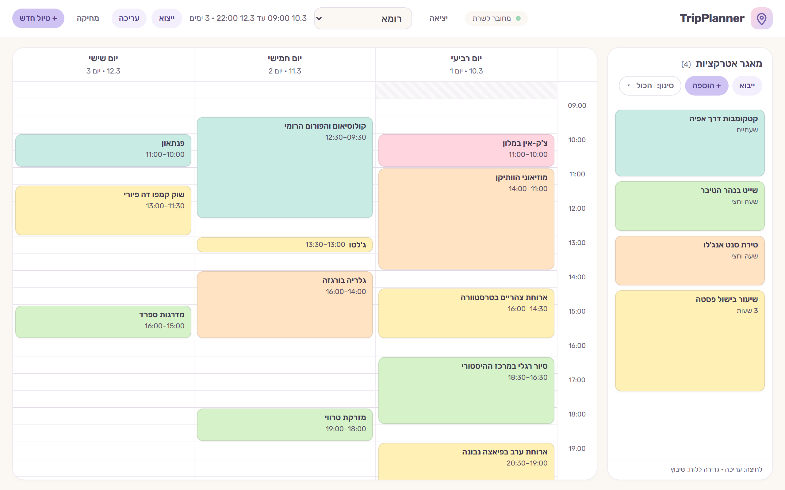
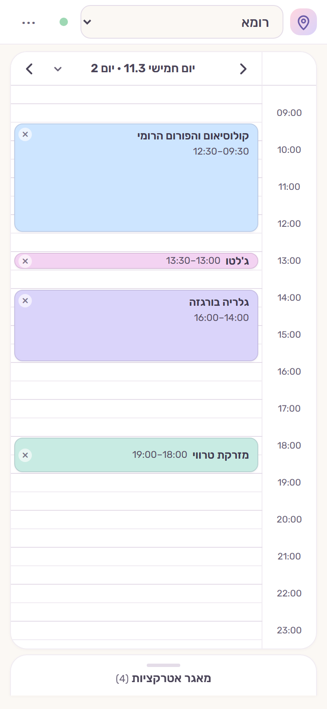
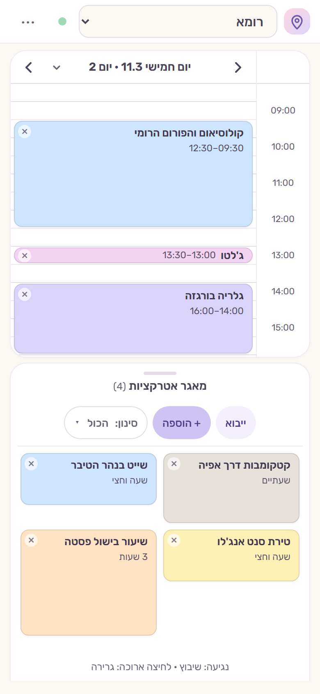
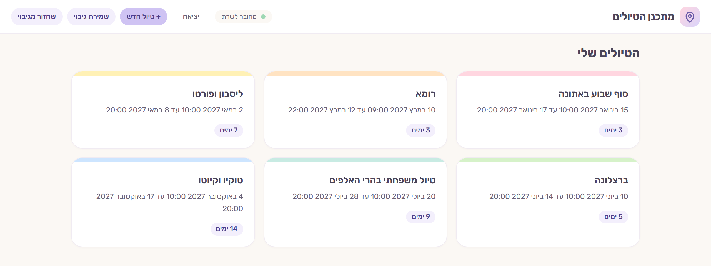

# TripPlanner

**A visual, timetable-first trip planner.** Set the trip's dates and hours, collect colored activity
blocks whose height matches their duration, and drag them into a half-hour grid covering every day of
the trip. You see at a glance how full each day is, and rearranging the plan is as simple as moving
a block.

Hebrew, right-to-left, works on desktop and phone, and keeps working without an internet connection.



<p align="center">
  
  &nbsp;&nbsp;
  
</p>



## Why

Most travel planners (TripIt, Wanderlog, Google Travel) are lists and maps. I plan trips by *time*:
how many hours does each museum take, does lunch still fit, is Tuesday overloaded? The project
started as a single-file prototype for my own trips ([prototype/index.html](prototype/index.html))
and grew into a real product with a cloud database, accounts and a phone experience.

## Features

- **Timetable planning:** every day of the trip in half-hour rows, with hours outside the trip
  window greyed out. Drag blocks from the bank into the grid, move them between days, or send them
  back to the bank.
- **Phone-friendly:** a single-day view with swipe between days, a bottom-sheet activity bank,
  long-press to drag, and tap-to-place as an alternative to dragging.
- **Works offline:** installable on the home screen (PWA); a saved trip opens and can be read
  without a connection, and the app catches up when it is back online.
- **Safe by design:** the database itself rejects overlapping activities, activities outside the
  trip and trips longer than 90 days. Shortening a trip automatically returns activities that no
  longer fit to the bank.
- **Bulk import:** paste a list of activities from Excel or plain text.
- **Export and backup:** export the timetable as an image or PDF; back up and restore trips as JSON.
- **Accessible:** keyboard placement, screen-reader labels and contrast checks (axe) in the
  automated tests.

## How it was built

I am the product owner of this project, and the code was written by AI coding agents
([Claude Code](https://claude.com/claude-code)) that I directed. My part:

- **Product and requirements:** wrote the product definition, scope and non-goals, and the
  acceptance criteria for each milestone ([PROJECT_PLAN.md](PROJECT_PLAN.md)).
- **Decisions:** chose between the trade-offs the agents raised (for example, building the drag
  and drop on the prototype's own logic instead of a library with a right-to-left bug, and
  shipping a web app before native apps). Decisions are logged in [DECISIONS.md](DECISIONS.md) and
  [docs/decisions/](docs/decisions/).
- **Process:** set up a small "team" of specialized agents (database, core logic, frontend,
  timetable, platform, QA, code review) with clear file ownership, a review step before every
  commit and a demo at the end of each milestone ([AGENT_WORKFLOW.md](AGENT_WORKFLOW.md)).
- **Acceptance:** reviewed a demo at the end of each milestone and approved it before dependent
  work started.

The project is also an experiment in how far careful product work, written rules and automated
checks can take AI-written code. The guardrails that make that work are in the repository:
[DEVELOPMENT_GUIDELINES.md](DEVELOPMENT_GUIDELINES.md), lint rules that enforce module boundaries,
and the test suite below.

## Quality

- Over 1,400 unit and component tests (Vitest), about 100 end-to-end browser tests on desktop and
  phone sizes (Playwright, against an in-process fake backend), and over 350 database tests for
  constraints and row-level security.
- Every change runs lint, type checks and tests in GitHub Actions.
- Every task passed an automated code and security review before it was committed.

## Tech stack

| Area | Choice |
| --- | --- |
| Frontend | React 18, TypeScript (strict), Vite, Tailwind CSS |
| Data | TanStack Query (optimistic updates, offline persistence) |
| Backend | Supabase: Postgres, Auth, row-level security, SQL functions |
| Dates and i18n | date-fns, react-day-picker, i18next (Hebrew, RTL) |
| Export | Canvas renderer, jsPDF |
| Delivery | Installable PWA; Windows and Android apps planned |
| Testing | Vitest, Testing Library, Playwright, axe-core |

## Status

In active development and in daily use. The core planner, phone view, offline reading,
import/export, tags, AI-assisted import and the installable PWA are done, and the web app is
deployed on Cloudflare Pages. See [TASKS.md](TASKS.md) and [DECISIONS.md](DECISIONS.md).

## For developers

Requirements: Node.js 24+ and a Supabase project.

```bash
npm install
cp .env.example .env.local   # then fill in the Supabase URL + publishable key
npm run dev                  # http://localhost:5173
```

Never put the database password or the secret / service_role key in `.env.local` or in the repo.

| Command             | What it does                                         |
| ------------------- | ---------------------------------------------------- |
| `npm run dev`       | Start the dev server                                 |
| `npm run build`     | Type-check and build to `dist/`                      |
| `npm run lint`      | ESLint (includes module-boundary rules)              |
| `npm run typecheck` | TypeScript strict check                              |
| `npm run test`      | Unit and component tests (Vitest)                    |
| `npm run test:e2e`  | End-to-end tests (Playwright, fake backend)          |
| `npm run check`     | Everything CI runs, except the build                 |

```text
src/
  app/             routing, providers, layout, error screens
  components/ui/   shared UI primitives
  domain/          pure business logic (no React / Supabase)
  data/            the ONLY place that talks to Supabase
  features/        auth, trips, bank, schedule, import, export, backup
  platform/        web / desktop / mobile adapters
  i18n/            translations (Hebrew)
  styles/          Tailwind + design tokens
supabase/          migrations, RLS policies, database tests
tests/e2e/         Playwright tests and the fake backend
prototype/         original single-file prototype
docs/decisions/    architecture decision records (ADRs)
```

Module boundaries are enforced by ESLint; see `eslint.config.js` and PROJECT_PLAN §4.3.

## License

[MIT](LICENSE)
